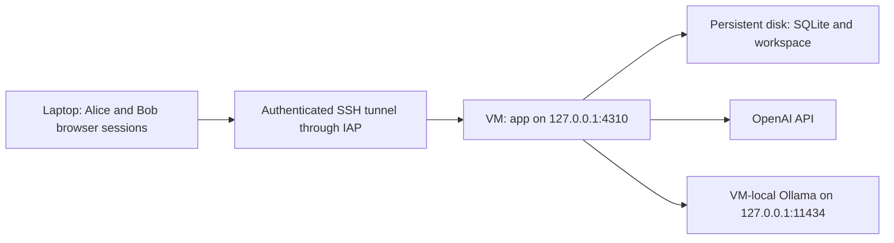

# GCP deployment and demonstration guide

**Status: prepared November 9, 2026; not deployed or Linux-verified.** This guide explains what you would set up and which commands you would run. Writing it did not create resources, change IAM, use credentials, or call a model. Record actual VM results before presenting them as cloud evidence.

Use this as the step-by-step companion to the [deployment kit](apps/collab-demo/deploy/README.md), [presentation](presentations/take-home/README.md), and [project wiki](llm-wiki/README.md). Replace uppercase placeholders. Follow the stages individually; the formatting and teardown steps are deliberately **not** an unattended installation script.

Jump to [cloud setup](#3-laptop-powershell-project-apis-and-access), [VM installation](#5-vm-bash-tools-and-a-mounted-data-directory), [Ollama](#7-vm-bash-run-ollama-for-the-mixed-default), [browser access](#10-laptop-powershell-open-the-gcp-app), [demonstrations](#11-demonstrations-and-exact-commands), [backup](#12-idle-restart-backup-and-acceptance-record), or [teardown](#14-teardown-from-laptop-powershell).

## 1. What you are deploying

One Linux VM runs one owner of the SQLite store and shared workspace. The browser app listens on the VM's loopback interface; an SSH tunnel makes it available at `http://127.0.0.1:4310` on your laptop.



The commands below give the VM an external IP for outbound downloads/API calls, but permit inbound SSH only from Google's Identity-Aware Proxy (IAP). They do not expose ports 4310 or 11434 publicly. A VM without an external IP is another option, but would need an outbound networking solution such as Cloud NAT; that is outside this small setup. [IAP access documentation](https://docs.cloud.google.com/iap/docs/using-tcp-forwarding).

| Identity or setting | What it is for |
| --- | --- |
| Google account and GCP project | Own and administer the VM, network, disks, and billing |
| Linux user `pi-collab` | Run the app; distinct from your administrator SSH user |
| Alice/Bob tokens | Sign in to this project's browser UI; not Google credentials |
| `OPENAI_API_KEY` | Pay for/access OpenAI model calls; GCP credits do not provide this |
| Ollama | Serve the downloaded model on the VM; no paid model key required |

The current default is **OpenAI + Ollama**, not Codex. Two providers through native Pi are different from two external harnesses. See [provider/harness definitions](llm-wiki/09-technical-terms.md#provider-model-agent-harness-and-adapter).

## 2. Before creating resources

1. Choose a project you control and link an active billing account in the Cloud Console. If using promotional credits, check your actual eligibility and balance rather than assuming the assignment's advertised credit applies.
2. Set a project-scoped billing alert and a teardown date. The earlier project planning ceiling was $30 infrastructure plus $10 provider testing, not a guaranteed price or automatic spending stop. **An alerts-only budget does not cap spending.** [Google budget guidance](https://docs.cloud.google.com/billing/docs/how-to/budgets).
3. Review the chosen VM, disk, external-IP, and network costs in the [pricing calculator](https://cloud.google.com/products/calculator). Keep OpenAI billing/limits separate.
4. Have the URL and exact reviewed commit of **your fork containing this feature**. A clone does not include uncommitted local changes; do not accidentally deploy the original upstream repository without the collaboration code.
5. Have your OpenAI key available privately. Do not upload your Windows `.env`, gcloud credential cache, `node_modules`, or running SQLite files.

The example machine is `e2-standard-4` (4 vCPUs, 16 GB RAM), with a 50-GB boot disk and a separate 30-GB data disk. This is a starting configuration for building and trying CPU inference, **not a measured Ollama performance recommendation**. Verify availability, pricing, and actual model latency before relying on it. [E2 machine types](https://docs.cloud.google.com/compute/docs/general-purpose-machines#e2_machine_types).

If CPU Ollama is too slow, choose a hosted-only two-agent composition before the first start, or use recorded/local inference evidence. Do not assume the Windows GPU result applies to this VM; do not silently change agents in an existing store.

## 3. Laptop PowerShell: project, APIs, and access

Open PowerShell in `E:\Github\pi`. The prepared CLI is repository-local; authentication is an interactive step you complete yourself.

```powershell
. .\.artifacts\env.ps1
gcloud auth login

$ProjectId = 'YOUR_GLOBALLY_UNIQUE_PROJECT_ID'
$Region = 'us-central1'
$Zone = 'us-central1-a'
$VmName = 'pi-collab-demo'
$DataDisk = 'pi-collab-data'
$Network = 'pi-collab-net'
$Subnet = 'pi-collab-subnet'
$OperatorEmail = 'YOUR_GOOGLE_ACCOUNT_EMAIL'
```

If creating a new project, run this once, then link billing in the Console. Skip it for an existing project:

```powershell
gcloud projects create $ProjectId --name='Pi collaboration take-home'
```

After billing is linked:

```powershell
gcloud config set project $ProjectId
gcloud services enable compute.googleapis.com iap.googleapis.com oslogin.googleapis.com --project=$ProjectId
```

The setup operator needs permission to enable APIs, create Compute/network/disk resources, and grant project roles. Use your authorized project administrator account; do not solve missing access by granting an evaluator Owner. An administrator grants these login roles to the operator:

```powershell
gcloud projects add-iam-policy-binding $ProjectId --member="user:$OperatorEmail" --role=roles/iap.tunnelResourceAccessor
gcloud projects add-iam-policy-binding $ProjectId --member="user:$OperatorEmail" --role=roles/compute.osAdminLogin
gcloud projects add-iam-policy-binding $ProjectId --member="user:$OperatorEmail" --role=roles/compute.viewer
```

OS Admin Login supplies administrator SSH access. For another person who needs their own tunnel, use OS Login without admin privileges, IAP tunnel access, and required Compute read access; organization/external-user policies can require additional approval. A person watching your screen needs no GCP login. App tokens remain a separate requirement. [OS Login role requirements](https://docs.cloud.google.com/compute/docs/oslogin/set-up-oslogin).

## 4. Laptop PowerShell: network, disks, and VM

Create a dedicated network rather than depending on a project's possibly absent or permissive default network:

```powershell
gcloud compute networks create $Network --subnet-mode=custom --project=$ProjectId
gcloud compute networks subnets create $Subnet --network=$Network --region=$Region --range=10.70.0.0/24 --project=$ProjectId
gcloud compute firewall-rules create pi-collab-iap-ssh --network=$Network --allow=tcp:22 --source-ranges=35.235.240.0/20 --target-tags=pi-collab --project=$ProjectId

gcloud compute disks create $DataDisk --zone=$Zone --size=30GB --type=pd-balanced --project=$ProjectId
gcloud compute instances create $VmName `
  --project=$ProjectId --zone=$Zone `
  --machine-type=e2-standard-4 `
  --image-family=debian-12 --image-project=debian-cloud `
  --boot-disk-size=50GB --boot-disk-type=pd-balanced `
  --network=$Network --subnet=$Subnet --tags=pi-collab `
  --metadata=enable-oslogin=TRUE `
  --no-service-account --no-scopes `
  --disk="name=$DataDisk,device-name=pi-collab-data,mode=rw,auto-delete=no"
```

The VM intentionally has no attached Google service account: the agent does not need ambient GCP API credentials. The separate disk is retained when the VM is deleted, so it also needs separate cleanup. The OS image family resolves at creation time; record the resulting image/revision for your evidence. [VM creation flags](https://docs.cloud.google.com/sdk/gcloud/reference/compute/instances/create), [persistent disk creation](https://docs.cloud.google.com/compute/docs/disks/add-persistent-disk).

Connect to the VM:

```powershell
gcloud compute ssh $VmName --project=$ProjectId --zone=$Zone --tunnel-through-iap
```

Everything in the next five sections runs in the VM's **Linux Bash terminal**, not laptop PowerShell.

## 5. VM Bash: tools and a mounted data directory

```bash
set -euo pipefail
sudo apt-get update
sudo apt-get install -y git curl ca-certificates xz-utils zstd rsync util-linux e2fsprogs less nano
sudo useradd --system --user-group --home-dir /var/lib/pi-collab-home --shell /usr/sbin/nologin pi-collab
sudo install -d -m 0700 -o pi-collab -g pi-collab /var/lib/pi-collab-home
lsblk -f
readlink -f /dev/disk/by-id/google-pi-collab-data
```

**Format only the new, empty data disk created above.** Confirm its device mapping and size in `lsblk`; never format the boot disk or a disk containing a previous demo. The next block refuses a recognized existing filesystem, but that is not a substitute for checking the correct disk:

```bash
DATA_DEVICE=/dev/disk/by-id/google-pi-collab-data
test -b "$DATA_DEVICE"
if sudo blkid "$DATA_DEVICE"; then
  printf 'Existing signature found: stop and inspect; do not format.\n' >&2
  exit 1
fi
sudo mkfs.ext4 -m 0 -L pi-collab-data "$DATA_DEVICE"
sudo install -d -m 0755 /var/lib/pi-collab
DATA_UUID=$(sudo blkid -s UUID -o value "$DATA_DEVICE")
printf 'UUID=%s /var/lib/pi-collab ext4 defaults,nofail 0 2\n' "$DATA_UUID" | sudo tee -a /etc/fstab
sudo systemctl daemon-reload
sudo mount /var/lib/pi-collab
findmnt /var/lib/pi-collab
sudo chown pi-collab:pi-collab /var/lib/pi-collab
sudo chmod 0700 /var/lib/pi-collab
```

The UUID entry makes the mount persistent. `nofail` lets the VM boot without that disk; the application's mount guard must still refuse startup when it is missing. Do not rerun the formatting or append another fstab entry on a later login. [Google's Linux disk/mount procedure](https://docs.cloud.google.com/compute/docs/disks/format-mount-disk-linux).

Install the Linux version of the prepared Node release, checking the downloaded archive:

```bash
NODE_VERSION=v22.23.4
NODE_ARCHIVE="node-${NODE_VERSION}-linux-x64.tar.xz"
mkdir -p "$HOME/pi-install"
cd "$HOME/pi-install"
curl -fSLO "https://nodejs.org/dist/${NODE_VERSION}/${NODE_ARCHIVE}"
curl -fSLO "https://nodejs.org/dist/${NODE_VERSION}/SHASUMS256.txt"
grep " ${NODE_ARCHIVE}$" SHASUMS256.txt | sha256sum --check -
sudo test ! -e /opt/node
sudo install -d -m 0755 /opt/node
sudo tar -xJf "$NODE_ARCHIVE" -C /opt/node --strip-components=1
export PATH="/opt/node/bin:$PATH"
node --version
node -e "const {DatabaseSync}=require('node:sqlite'); const db=new DatabaseSync(':memory:'); db.close(); console.log('SQLite available')"
```

Use `export PATH="/opt/node/bin:$PATH"` in each new SSH terminal, or add that non-secret line to your own `~/.profile`. Do not put provider keys there. This pin matches the local project's Node version; a later upgrade needs its own verification. [Official Node 22.23.4 release](https://nodejs.org/en/blog/release/v22.23.4).

An experimental SQLite warning on Node 22 is different from a missing `node:sqlite` module; the warning alone does not mean the check failed.

## 6. VM Bash: install the reviewed fork and build

These commands assume `/opt/pi` does not already contain a deployment. The checkout belongs to your operator user for installation/tests; the service runs as the separate `pi-collab` account with read-only code access.

```bash
umask 022
sudo test ! -e /opt/pi
sudo install -d -m 0755 -o "$USER" -g "$(id -gn)" /opt/pi
git clone YOUR_FORK_CLONE_URL /opt/pi
cd /opt/pi
git checkout --detach YOUR_REVIEWED_COMMIT
git rev-parse HEAD
test -f packages/durable/src/collaboration/index.ts
npm ci --ignore-scripts --no-audit --no-fund

mkdir -p .artifacts
CATALOG_REVISION=$(node -p "JSON.parse(require('node:fs').readFileSync('nix/model-catalog.json','utf8')).revision")
curl -fSL "https://pi.dev/api/models/revisions/${CATALOG_REVISION}?types=chat,image,classifier" -o .artifacts/models.all.json
printf '%s  %s\n' "${CATALOG_REVISION#sha256-}" .artifacts/models.all.json | sha256sum --check -
node --conditions=source --experimental-strip-types packages/ai/scripts/hydrate-model-catalog.ts .artifacts/models.all.json
npm run build:offline
cd /opt/pi/apps/collab-demo
npm run check
npm run build
```

The catalog is pinned by the checked-out repository; do not refresh it to a different live revision just to get a build. Hydration writes ignored provider data, not a manually edited model catalog. The offline build then avoids catalog refresh. Package lifecycle scripts remain disabled. If this fresh Linux installation exposes a native-package/build issue, record it rather than claiming the local Windows build verified Linux. [Environment details](TAKE_HOME_ENVIRONMENT.md).

For a private fork, authenticate Git privately using your normal reviewed method; do not embed a personal access token in the clone URL or copy your entire developer home to the VM.

## 7. VM Bash: run Ollama for the mixed default

The Windows portable `ollama.exe` is not usable on this VM. Use the official Linux installer, selecting the recorded version rather than silently using latest:

```bash
cd "$HOME/pi-install"
curl -fsSL https://ollama.com/install.sh -o ollama-install.sh
less ollama-install.sh
sudo env OLLAMA_VERSION=0.40.15 sh ./ollama-install.sh
sudo install -d -m 0755 /etc/systemd/system/ollama.service.d
sudoedit /etc/systemd/system/ollama.service.d/pi-demo.conf
```

Put this in the drop-in editor:

```ini
[Service]
Environment="OLLAMA_HOST=127.0.0.1:11434"
Environment="OLLAMA_CONTEXT_LENGTH=8192"
Environment="OLLAMA_NUM_PARALLEL=1"
Environment="OLLAMA_MAX_LOADED_MODELS=1"
Environment="OLLAMA_NO_CLOUD=1"
```

Then:

```bash
sudo systemctl daemon-reload
sudo systemctl restart ollama.service
ollama --version
ollama pull qwen3:4b-instruct-2507-q4_K_M
ollama list
curl --fail --silent --show-error http://127.0.0.1:11434/api/tags
```

Record the actual model digest, not just its mutable tag. The listing proves availability, **not successful tool use**; verify actual files through the app before rehearsal. CPU inference may be slow, and one inference slot is intentional. If a pinned Linux artifact is unavailable, stop and select/retest an explicit version. [Official Linux installation instructions](https://github.com/ollama/ollama/blob/main/docs/linux.mdx), [Ollama environment configuration](https://docs.ollama.com/faq), [project local-model evidence](apps/collab-demo/LOCAL_MODELS.md).

The app service does not wait for an Ollama readiness probe. Check the backend separately after reboot and before rehearsal; preflight only checks declarations.

Ollama's own service/model cache is separate from the app data directory. Replacing the VM requires reinstalling/re-pulling it or preserving its cache separately; it is not part of the app's stopped-store backup.

## 8. VM Bash: configuration, secrets, and preflight

Keep configuration and secrets outside the checkout/workspace. The first two files below must be new; do not overwrite a previous deployment's credentials:

```bash
cd /opt/pi
sudo install -d -m 0750 -o root -g pi-collab /etc/pi-collab
sudo test ! -e /etc/pi-collab/config.json
sudo test ! -e /etc/pi-collab/host.env
sudo install -m 0640 -o root -g pi-collab apps/collab-demo/config.example.json /etc/pi-collab/config.json
sudo install -m 0600 -o root -g root apps/collab-demo/deploy/host.env.example /etc/pi-collab/host.env
```

Generate Alice/Bob tokens directly into that private file without printing them:

```bash
cat > /opt/pi/.artifacts/prepare-host-tokens.mjs <<'JS'
import { randomBytes } from 'node:crypto';
import { readFileSync, writeFileSync } from 'node:fs';
const path = '/etc/pi-collab/host.env';
let contents = readFileSync(path, 'utf8').replaceAll('\r\n', '\n');
for (const name of ['COLLAB_TOKEN_ALICE', 'COLLAB_TOKEN_BOB']) {
  contents = contents.replace(new RegExp(`^${name}=$`, 'm'), `${name}=${randomBytes(24).toString('base64url')}`);
}
writeFileSync(path, contents, { mode: 0o600 });
JS
sudo /opt/node/bin/node /opt/pi/.artifacts/prepare-host-tokens.mjs
sudoedit /etc/pi-collab/host.env
```

In the private editor, fill `OPENAI_API_KEY` and confirm:

```dotenv
COLLAB_CONFIG=/etc/pi-collab/config.json
COLLAB_DATA=/var/lib/pi-collab
COLLAB_PORT=4310
COLLAB_OLLAMA_URL=http://127.0.0.1:11434/v1
```

Keep the generated token lines. They are browser passwords; retrieve them privately before screen-sharing. `CODEX_BIN` may remain unused for this native-only composition. This is a **systemd EnvironmentFile**, so use `NAME=value`, not `export`, and do not source it into an administrator shell. The unit loads it on every start; the app's local `.env` is not needed.

The copied config selects agent IDs `openai` and `ollama`, with `gpt-5.4-mini` and the Qwen3 model above. If deliberately choosing two hosted agents instead, edit this private JSON **before first startup**. Changing stored members/agents/models requires a fresh store and a deliberate unit/mount plan later, not deleting the existing database.

Run read-only preflight under the service identity/environment:

```bash
sudo systemd-run --unit=pi-collab-preflight --collect --wait --pipe \
  --property=User=pi-collab --property=Group=pi-collab \
  --property=WorkingDirectory=/opt/pi/apps/collab-demo \
  --property=EnvironmentFile=/etc/pi-collab/host.env \
  --setenv=HOME=/var/lib/pi-collab-home \
  --setenv=PATH=/opt/node/bin:/usr/local/bin:/usr/bin:/bin \
  /opt/node/bin/node --conditions=source --experimental-strip-types src/preflight.ts
```

Expected: `configuration-valid`, two members, the selected agents, and an empty `missingKeys` list. It opens no runtime store and makes no model request. It does not establish valid API credit, Ollama readiness, tool quality, disk permissions, or process containment.

## 9. VM Bash: install and start the app service

```bash
sudo install -m 0644 /opt/pi/apps/collab-demo/deploy/pi-collab.service /etc/systemd/system/pi-collab.service
sudo systemd-analyze verify /etc/systemd/system/pi-collab.service
sudo systemctl daemon-reload
sudo systemctl start pi-collab.service
sudo systemctl status pi-collab.service --no-pager
sudo ss -ltnp '( sport = :4310 or sport = :11434 )'
```

Both listeners should be loopback-only. Inspect failures privately with:

```bash
sudo journalctl -u pi-collab.service -n 60 --no-pager
sudo journalctl -u ollama.service -n 60 --no-pager
findmnt /var/lib/pi-collab
```

The template uses prebuilt browser assets and direct Node execution. Do not replace it with `npm start`: that command rebuilds assets and is inappropriate under the unit's read-only code policy. Do not run another manual owner against `/var/lib/pi-collab`. `Restart=no` is intentional; do not hide uncertain failures with an automatic restart loop. All agent tools still run with the service user's access, including access to its environment; this is not a hostile-user sandbox.

## 10. Laptop PowerShell: open the GCP app

In a separate laptop terminal, activate the prepared tools and set the same project/zone/VM values as section 3; PowerShell variables do not carry into a new window. Keep this tunnel running:

```powershell
Set-Location E:\Github\pi
. .\.artifacts\env.ps1
$ProjectId = 'YOUR_GLOBALLY_UNIQUE_PROJECT_ID'
$Zone = 'us-central1-a'
$VmName = 'pi-collab-demo'
gcloud compute ssh $VmName --project=$ProjectId --zone=$Zone --tunnel-through-iap -- -N -L 4310:127.0.0.1:4310 -o ExitOnForwardFailure=yes
```

Open `http://127.0.0.1:4310` in two browser profiles. Sign in as Alice and Bob using the private tokens. **This localhost address reaches the VM through SSH; it is not the laptop's local app.** Stop any local demo using port 4310 first, or use `-L 14310:127.0.0.1:4310` and open `http://127.0.0.1:14310` instead. `ExitOnForwardFailure` prevents quietly mistaking an existing local listener for GCP. [IAP SSH connection guidance](https://docs.cloud.google.com/compute/docs/connect/ssh-using-iap).

## 11. Demonstrations and exact commands

Use the browser for shared work and file inspection. Use the VM terminal for deterministic races, recovery tests, and load evidence; there is no current conflict-control or performance dashboard in the GUI.

| Demonstration | Where | Key/model requirement | What it proves |
| --- | --- | --- | --- |
| Shared users, files, reconnect | Browser through tunnel | Running configured OpenAI/Ollama | Real tool integration and shared state |
| Six user/agent pairs, same-agent queue, stale overwrite | Isolated app tests on VM | None | Controlled coordination/race assertions |
| Managed conflict and explicit resolution | Standalone example 41 on VM | None | Opt-in package protection, not live tool protection |
| Same-ID retry and changed-text rejection | VM HTTP client below | One accepted native command can spend model tokens | HTTP acceptance/deduplication behavior |
| Crash/recovery boundaries | Isolated Durable tests on VM | None | Selected fixture crashes, not arbitrary process containment |
| Burst/soak load | Isolated load runner on VM | None | Real SQLite/HTTP/SSE with simulated execution |

### A. Browser: four pairings and actual files

Use a disposable presentation workspace and paste these prepared instructions:

1. **Alice → openai:** `Use the write tool once to create alice.txt containing exactly ALICE-ONE. Then reply DONE.`
2. **Bob → openai:** `Use the edit tool once on alice.txt to replace ALICE-ONE with ALICE-TWO. Then reply DONE.`
3. **Bob → ollama:** `Use the write tool once to create bob.txt containing exactly BOB-ONE. Then reply DONE.`
4. **Alice → ollama:** `Use the read tool on bob.txt, then reply with only its contents.`

Inspect `alice.txt` and `bob.txt` in **Workspace files · Read only**, using manual Refresh. Expected final bytes: `ALICE-TWO` and `BOB-ONE`. Closing Alice's page does not cancel accepted work; let Bob observe completion, then reopen/relogin as Alice and inspect saved history. Do not resubmit just to restore the view.

If step 1 finishes before Bob submits, that live run did not show a queue. Use B's deterministic queue test rather than claiming you saw overlap. Likewise, only use Stop on rehearsed disposable work: it affects the whole selected agent and does not undo file changes. [GUI guarantees](llm-wiki/06-web-and-demonstration.md#what-the-current-gui-can-prove).

### B. VM Bash: deterministic M:N, queueing, and lost update

These tests create their own runtime/servers and temporary files; no running demo server or provider keys are required. Run as your checkout-owning SSH user, not as the protected app service:

```bash
export PATH="/opt/node/bin:$PATH"
cd /opt/pi/apps/collab-demo
node /opt/pi/node_modules/vitest/dist/cli.js --run test/concurrency.test.ts
```

Expected: three passing cases. They verify six user/agent pairings, a same-agent `running`/`queued` ordering, and a forced stale overwrite ending in `base|bob` after Alice's change was erased. The test assertions establish the controlled ordering; a PASS line is not a visual GUI conflict walkthrough. [Test source](apps/collab-demo/test/concurrency.test.ts), [lost-update explanation](llm-wiki/04-files-and-conflicts.md#the-lost-update-example-to-remember).

To show just the overwrite case:

```bash
node /opt/pi/node_modules/vitest/dist/cli.js --run test/concurrency.test.ts -t 'lost update'
```

### C. VM Bash: protected edit, retained conflict, explicit resolution

```bash
cd /opt/pi/packages/durable
node --conditions=source --experimental-strip-types test/examples/41-managed-file-conflict.ts
```

Expected output includes Alice applied, Bob conflict, `Current (Alice preserved): base + alice`, a successful resolution, and retained proposal evidence. The example explicitly supplies `base + alice + bob` as the resolution. It uses actual temporary files with scripted participants and cleans them up; there is no model call or automatic merge. **Normal browser agents do not use this managed API yet.**

For a second standalone coordination example with actual SQLite and simulated native/external agents:

```bash
node --conditions=source --experimental-strip-types test/examples/38-collaborative-thread.ts
```

It shows shared files, a stable receipt retry, and Bob observing Alice's lane, independently of the live service. [Managed-file explanation](llm-wiki/04-files-and-conflicts.md#managed-publication-and-optimistic-concurrency-control).

### D. VM Bash: same-ID retry over the actual HTTP API

This optional client targets the running **live** service, thread `project`, agent `openai`. It submits one new logical instruction, repeats the same ID/text, then tries changed text under that ID. The token is read privately into memory, not placed in command-line arguments.

```bash
mkdir -p "$HOME/pi-collab-evidence"
cat > "$HOME/pi-collab-evidence/retry-demo.mjs" <<'JS'
const token = process.env.COLLAB_DEMO_TOKEN;
const id = process.argv[2];
if (!token || !id) throw new Error('Provide a private Alice token and a request ID');
const url = 'http://127.0.0.1:4310/api/threads/project/agents/openai/commands';
const text = 'Reply with only RETRY-DEMO. Do not use tools or change files.';
for (const [label, instruction, expected] of [
  ['first send', text, 202],
  ['same-ID retry', text, 202],
  ['same ID with changed text', 'This is different text.', 409],
]) {
  const response = await fetch(url, {
    method: 'POST',
    headers: { Authorization: `Bearer ${token}`, 'Content-Type': 'application/json' },
    body: JSON.stringify({ id, text: instruction }),
  });
  console.log(label, response.status, await response.json());
  if (response.status !== expected) throw new Error(`Expected ${expected}`);
}
JS
read -rs -p 'Alice token (private; not echoed): ' COLLAB_DEMO_TOKEN
printf '\n'
export COLLAB_DEMO_TOKEN
node "$HOME/pi-collab-evidence/retry-demo.mjs" "presentation-retry-$(date +%s)"
unset COLLAB_DEMO_TOKEN
```

Expected HTTP statuses: **202, 202, 409**. The two accepted replies identify the same user/agent/request, and changed text is refused. Inspect the corresponding instruction in Alice's shared agent history. This proves duplicate-safe **admission**, not a general exactly-once model/file guarantee. If retrying after a genuinely lost reply, preserve that original ID; do not generate a timestamped new ID. Use a new ID for a deliberate new run. [Retry scope](llm-wiki/02-commands-and-concurrency.md#retry-identity-and-idempotent-admission).

### E. VM Bash: selected crash/recovery scenarios

```bash
cd /opt/pi/packages/durable
node /opt/pi/node_modules/vitest/dist/cli.js --run test/collaboration-recovery.test.ts test/collaboration-boundaries.test.ts
```

These use controlled fixture processes, temporary stores, and simulated model/driver behavior. They do not kill the presentation service or require real Codex/OpenAI calls. Record their actual Linux result; Windows passes do not prove Linux containment. Do not add the deferred slow native Bash case or raise runner timeouts and call that a fix. [Recovery interpretation](llm-wiki/03-durability-and-recovery.md).

### F. VM Bash: smoke or full soak load

Run outside the live service's store. The runner creates independent temporary SQLite stores and HTTP servers, then removes them; its output path is retained:

```bash
mkdir -p "$HOME/pi-collab-evidence"
cd /opt/pi/apps/collab-demo
node --conditions=source --experimental-strip-types load/run.ts 5 "$HOME/pi-collab-evidence/load-smoke.json"
```

For the approximately ten-minute soak instead:

```bash
node --conditions=source --experimental-strip-types load/run.ts 600 "$HOME/pi-collab-evidence/load-soak.json"
```

The short run still includes baseline and burst phases; it is not a five-second end-to-end deadline or soak evidence. Both modes use **simulated agent execution over real SQLite/HTTP/SSE**, not hosted-model throughput. Running load on the same VM can slow the live demo, so do it outside presentation time. Read the [workload/report](apps/collab-demo/load/README.md) before interpreting counts, latency, or memory.

Copy a retained report to the laptop from **laptop PowerShell**:

```powershell
gcloud compute scp "${VmName}:~/pi-collab-evidence/load-smoke.json" .artifacts/gcp-load-smoke.json --project=$ProjectId --zone=$Zone --tunnel-through-iap
```

## 12. Idle restart, backup, and acceptance record

Before stopping the app, wait for both lanes to be idle. In **VM Bash**:

```bash
sudo systemctl stop pi-collab.service
sudo systemctl show pi-collab.service --property=ActiveState --property=SubState --property=ControlGroup
if ! sudo systemd-cgls /system.slice/pi-collab.service; then
  printf 'No cgroup listing: confirm it is absent, or diagnose the inspection failure, before proceeding.\n'
fi
```

An absent cgroup can be expected after a complete stop. Confirm no former app/child writer remains; a closed port alone is insufficient. If shutdown is uncertain, inspect rather than starting another owner. An idle restart demonstrates narrower behavior than active crash recovery.

For a stopped-store backup, after that check:

```bash
sudo install -d -m 0700 /var/backups/pi-collab
ARCHIVE="/var/backups/pi-collab/demo-$(date -u +%Y%m%dT%H%M%SZ).tar.gz"
sudo bash /opt/pi/apps/collab-demo/deploy/backup.sh /var/lib/pi-collab "$ARCHIVE"
sudo tar --list --gzip --file="$ARCHIVE"
sudo systemctl start pi-collab.service
```

Reconnect browsers and inspect the same messages/files without resubmitting. The archive contains the full stopped data directory, including workspace and SQLite sidecars; credentials/configuration and the Ollama cache are separate. A backup on the same VM is only a staging copy: move it to private storage before deleting that VM. Treat it as sensitive and do not expose its contents during presentation.

To retrieve the archive, first stage a private copy owned by your SSH user on the VM:

```bash
mkdir -p "$HOME/pi-collab-evidence"
sudo install -m 0600 -o "$USER" -g "$(id -gn)" "$ARCHIVE" "$HOME/pi-collab-evidence/$(basename "$ARCHIVE")"
```

Then use laptop PowerShell, replacing the timestamp with the actual archive name:

```powershell
gcloud compute scp "${VmName}:~/pi-collab-evidence/demo-YYYYMMDDTHHMMSSZ.tar.gz" .artifacts/ --project=$ProjectId --zone=$Zone --tunnel-through-iap
```

Record these checks in your deployment evidence:

- Exact fork commit, Linux image, Node/Ollama versions, model digest, zone/machine, and actual configuration.
- Two-user browser/file demonstration and separate key-free scenario results.
- Successful idle reopen; verified old-writer cleanup before ownership replacement.
- Persistent mount after reboot and refusal to start with the mount missing.
- Restore into an isolated stopped installation using the same configuration and absolute workspace path.
- Separate authenticated Codex turn/continuation **only if you choose that optional harness**; a native OpenAI success or CLI initialization does not establish it.

Test reboot/missing-mount/restore outside the live presentation, following the [technical runbook](apps/collab-demo/deploy/README.md#evaluator-access-and-acceptance-checks). Only after those service checks should you enable boot startup with `sudo systemctl enable pi-collab.service`; this leaves `Restart=no` unchanged.

## 13. Troubleshooting

| Symptom | Check first |
| --- | --- |
| IAP/SSH denied | Active Google account/project, IAP and OS Login roles, VM metadata, tagged TCP-22 rule; organization policies |
| Browser shows an old local demo | Tunnel failed because local 4310 was occupied; use 14310 and `ExitOnForwardFailure` |
| Service skipped at startup | `findmnt /var/lib/pi-collab`; mount guard deliberately prevents fallback onto boot storage |
| `node:sqlite` missing | `node --version`, selected binary, and SQLite check; do not add a SQLite npm dependency |
| Missing provider data / `utils/*` exports | Hydrate the pinned catalog, run root offline build, then app build |
| Preflight passes but OpenAI fails | Account/key/model access and credits; preflight does not call OpenAI. Generic UI `model_error` may omit retained provider detail |
| Ollama connects but no files change | Correct pulled model/digest, app tool calls and actual file bytes; a DONE answer is not a content assertion |
| Config rejected on reopen | Changed fixed members/agents/models/workspace; preserve data and plan a fresh store, do not delete history |
| CLI example/test cannot write cache or report | Run as the checkout-owning operator; use your own writable evidence directory, not a second service owner |
| Fixture load passes but real agent is slow | Simulated service latency is not model/GPU/provider performance |

## 14. Teardown from laptop PowerShell

First export evidence and private backups, stop the service/VM as appropriate, and close SSH tunnels. **Deletion commands below are destructive**; inspect project/name variables and keep the CLI confirmations. Run only when the demonstration and recovery checks are finished.

```powershell
gcloud compute instances delete $VmName --project=$ProjectId --zone=$Zone
gcloud compute disks list --project=$ProjectId
gcloud compute disks describe $DataDisk --project=$ProjectId --zone=$Zone
```

The data disk was configured not to auto-delete. After confirming you have any needed archive, delete that retained disk and the dedicated networking resources:

```powershell
gcloud compute disks delete $DataDisk --project=$ProjectId --zone=$Zone
gcloud compute firewall-rules delete pi-collab-iap-ssh --project=$ProjectId
gcloud compute networks subnets delete $Subnet --project=$ProjectId --region=$Region
gcloud compute networks delete $Network --project=$ProjectId
gcloud compute instances list --project=$ProjectId
gcloud compute disks list --project=$ProjectId
gcloud compute snapshots list --project=$ProjectId
gcloud compute addresses list --project=$ProjectId
```

Also review retained backups, snapshots, any separately added resources, IAM access, and provider/token revocation. Stopping or deleting a VM alone does not establish zero remaining charges. Do not delete unrelated resources in an existing shared project. [Disk deletion settings](https://docs.cloud.google.com/compute/docs/disks/modify-persistent-disk).

## Immediate next work

Before actual deployment, supply the project/billing/IAM access and reviewed fork revision, then execute and record this guide on Linux. The current planned implementation remains the step-controlled conflict GUI, which needs no additional provider key or GCP. Real hosted demonstrations need the configured OpenAI key and a tested VM model setup; optional live Codex needs separate authentication. The Windows Bash investigation remains deferred.
