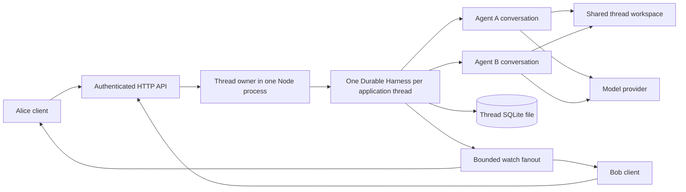

# Tentative implementation plan: a 20-hour collaborative Durable service

This plan addresses [the assignment](PROJECT_INSTRUCTIONS.txt) and builds on the [project guide](TAKE_HOME_PROJECT_GUIDE.md). It proposes implementation work; it does not claim that anything has been built, deployed, or measured.

## 1. Recommended scope and the first decision

Build a small TypeScript service with two named coding agents per application thread, several authenticated viewers, durable targeted input, live updates, reconnect, and a GCP deployment. Use a deliberately small client and spend the saved time on failure behavior and measurements.

**Recommended fast path: reuse Pi Durable behind an application-owned interface.** This contains framework coupling and avoids rebuilding checkpointing, inboxes, tool lifecycles, and transcript recovery. It retains Chord and other Durable dependencies internally. It is not a framework-free rewrite.

The assignment's framework criticism makes this a rubric risk. Resolve the interpretation in the first hour if possible. If eliminating those dependencies is mandatory, choose option B immediately and reduce runtime features as described below. Do not spend half the assignment on A and then attempt a rewrite.

| Option | What you build/reuse | Benefits | Costs and risks | Fit for 20 hours |
| --- | --- | --- | --- | --- |
| **A. Service around Durable** | Existing Harness, SQLite, coding tools, and inboxes; new collaborative API/client | Strongest chance of a deployed and tested result; preserves Durable behavior | Dependencies remain; limited harness portability until another adapter exists | Recommended if coupling can be contained behind the API |
| **B. Small replacement runtime** | Plain TypeScript, SQLite command/run records, Pi agent SDK, application scheduling | Directly addresses framework dependence; simpler domain model | Must implement admission, execution recovery, cancellation, streaming, and tool-effect uncertainty | Feasible only with narrower recovery semantics and strict scope cuts |
| **C. Build on T3's server** | Reuse provider infrastructure and existing event/effect architecture | Broad harness support and mature provider normalization | Effect remains; substantial domain/UI complexity; collaboration still needs policy | Use only if already familiar with T3; poor default for a two-day task |

For B, reuse `packages/agent` and the coding-agent SDK/tools rather than implementing an LLM tool loop from scratch. First prove the exact SDK API with a tiny executable spike. Persist queued commands, claim one run per agent, and mark any run that was active at restart `interrupted`; require explicit user retry. Recover queued work, but do not promise transparent recovery inside an active turn. That is a weaker, clearly stated version of durability.

For B, a command receipt and its pending execution record must commit together. Starting the SDK call happens afterward. A crash after effects begin leaves an uncertain outcome; never automatically replay that run. This is the minimum necessary correctness mechanism, not an optional distributed-system enhancement.

## 2. Minimum deliverable and explicit exclusions

The baseline must show:

- Two distinct authenticated users in one thread, each seeing the other's attributed requests and both agents' state.
- Two independent agents working concurrently against the same thread directory, initially on different files.
- One selected agent per command; another command to a busy agent queues. Steering is exposed only where the chosen runtime supports it.
- A durable receipt before reporting acceptance; retrying the same command does not create another run.
- Process restart and client reconnect behavior demonstrated with recorded outcomes.
- A deployed GCP instance, reproducible setup/teardown instructions, and a stress/failure report.

Use one real model provider and a deterministic test provider. Two harness implementations, automatic delegation, broadcast prompts, agent-to-agent chat, provider switching, terminal emulation, workspace rollback, production identity integration, autoscaling, and multi-zone availability are outside the baseline.

Agent conversations share files and a user-visible room, but not automatically every agent's private prompt history. Users explicitly address each agent. Describe that context policy in the UI and presentation. Automatic propagation of every agent response to every other agent invites loops and is unnecessary here.

## 3. Proposed architecture for option A



Deploy everything initially on one Compute Engine VM. Keep one owning process for each thread's Harness and SQLite file. One database per thread keeps storage failure and commit contention scoped to that thread, although a process or VM failure still affects all threads on that instance.

Use a small configured thread limit instead of implementing worker eviction or an unbounded cache. Reject excess work explicitly. On startup, reopen configured thread stores and resume them with the same registry and policies.

Proposed layout:

```text
apps/collab-agent/                  # new application, tentative name
  src/server.ts                    # transport, authentication, lifecycle
  src/threads.ts                   # membership and exclusive Harness ownership
  src/durable-runtime.ts           # only layer importing Durable/Chord
  src/streams.ts                   # bounded fanout and reconnect snapshots
  client/                          # minimal static client
  test/                            # admission, concurrency, recovery, reconnect
  load/                            # deterministic load driver
  deploy/                          # VM setup, supervisor, teardown
  README.md
```

Finalize the app's build/check integration during the initial spike. A new `apps/*` workspace needs its own explicit checks if root TypeScript configuration does not cover it. No changes to Chord or T3 are necessary for A.

The application interface needs only operations such as create/load thread, submit to agent, inspect submission, cancel, page history, and subscribe to state. Keep library handles, Chord contexts, and provider IDs behind it. Do not build a generic plugin framework to prove this boundary.

## 4. State, admission, and ordering

An **application thread** is the shared room and workspace. A **lane** is a named agent's independent conversation within that room.

| Record | Minimum content | Storage approach for A |
| --- | --- | --- |
| Thread configuration | Thread ID, members, server-selected workspace, agent-to-conversation mapping | An application document on the Harness root conversation |
| Agent lane | Agent ID, configured model/tools, conversation ID | Durable conversation and agent configuration |
| Input attribution | User ID, command ID, target agent, original text | `SubmissionDraft.entry` with an application entry kind |
| Command receipt | User/agent-scoped command ID, normalized payload, submission ID | Application document updated with the admission in the same commit |
| Execution/transcript | Submission, task, live-state, and entry records | Existing Durable records; avoid a second execution database |

Keep the root conversation for thread metadata; it need not run an agent. Create the peer conversations as ownerless and record their association with the application thread. Stopping one peer must not stop another peer through accidental parent-task ownership.

Command path:

1. Authenticate a server-configured token and derive the user ID. Never trust a user ID in the payload.
2. Validate the request at the network boundary: target, mode, text size, and command ID. Resolve the workspace from server state.
3. In one Harness commit, read membership, the existing receipt, and relevant capacity state. Return a matching stored receipt; reject a reused ID with different payload.
4. For a new command, call the target conversation's `submit(tx, draft)` once, before table writes. Include input author metadata and the scoped `requestId`. Store the returned submission ID and receipt in the application document.
5. Return acceptance only after the outer commit succeeds. The submission can still finish later or fail.

For the demo, retain receipts and apply a small hard command count per thread rather than growing an unlimited receipt document or inventing retention semantics. Check duplicate receipts before capacity rejection so retries of accepted commands still work when full. Use a separate test fixture with a suitable configured cap for load runs.

Example: Alice submits `c17` to A; storage commits; the HTTP connection dies. Alice retries `c17` and receives the original submission ID. Reusing `c17` with different text returns a conflict. Bob's separately scoped `c17` is a different command.

Within a lane, let Durable govern input placement and busy semantics. Across lanes, there is concurrency, not one global model transcript. Render separate lane panels with author/time labels. Do not imply that wall-clock timestamps create a strict cross-agent order.

Follow-up is the default. Steering joins at a supported model/tool boundary; it does not rewrite a request already in flight. Expose the current state and reason when a command cannot apply. Cancellation targets an authenticated, authorized lane or submission and must visibly settle rather than merely hide a spinner.

## 5. Streaming and reconnect without a second event platform

Use HTTP POST for commands and **Server-Sent Events (SSE)** for one-way updates. SSE is sufficient because commands already use HTTP. A WebSocket is reasonable if the implementation stack already has one, but is not necessary for this proof of concept.

Subscribe once per active lane on the server and fan updates out to viewers. Do not serialize and send full thread history per token or let a slow network writer block runtime publication.

Start each connection with bounded lane snapshots acquired through the runtime watch handles, then send subsequent updates. On reconnect, send fresh snapshots and page committed history as needed. This is simpler than promising gap-free incremental replay with a global cursor. Preserve UI messages by stable entry/submission IDs and replace transient partial text with current state.

Give each connection bounded pending output, coalesce superseded progress, and disconnect an over-limit viewer so it can resynchronize. Keep durable entries accessible through history paging. Dispose subscriptions and buffers on disconnect. Add periodic keepalives and test the deployed proxy's buffering behavior.

Proposed endpoints are `POST /threads/:id/agents/:agent/commands`, `GET /threads/:id/state`, `GET /threads/:id/events`, history paging, submission status, and cancellation. Authorize every endpoint, including SSE and history. Native browser EventSource does not accept arbitrary authorization headers: use authenticated `fetch` streaming for bearer tokens or a deliberately designed secure-cookie session. Do not put long-lived tokens in event URLs.

## 6. Filesystem and recovery policy

All agents in one thread use the same server-selected directory; different threads get different directories. Directory placement prevents accidental overlap, not malicious escape. Use trusted collaborators and disposable repositories for the baseline; arbitrary coding tools have the process's permissions.

Retain built-in edit/write serialization. Demonstrate different-file concurrency and a deliberately conflicting same-file case. Describe last-writer/stale-read behavior honestly. A hash-checked editing tool is optional after deployment; it cannot protect shell-based edits that bypass it.

For option A, install the same tools/extensions before recovery and invoke Harness resume. Preserve tool replay policy: do not mark arbitrary shell/edit operations replay-safe to make restart tests pass. Use deterministic replay-safe test work to prove automatic task recovery, and separately kill the process during a mutating shell tool to document the interrupted/uncertain result. Check for surviving child processes before admitting more writes after a forced process kill; the supervisor must terminate the whole service process group.

Bound model turns, retries, command duration, tool output, and per-lane queued input. A shell timeout is necessary because the built-in bash tool accepts commands without a default timeout. Set an application timeout rather than relying on model-supplied arguments. After a failed run, choose and test an explicit queued-input policy; the Durable default can leave queued inputs waiting for another input.

Client disconnection cancels only that client's observation. It must not abort the agent. Conversely, a real cancellation should propagate to tool execution, not just the HTTP request.

## 7. GCP deployment and cost

**Choose a single Compute Engine VM for the first version.** A modest Linux VM, initially around 2 vCPUs and 8 GiB RAM, is a starting test configuration, not a throughput claim or price quote. Attach persistent storage for SQLite and workspaces and supervise the process with systemd or an equivalent process-group-aware supervisor. Persistent Disk is durable block storage; a single zonal deployment still has an availability failure domain. See [Google's Persistent Disk documentation](https://docs.cloud.google.com/compute/docs/disks/persistent-disks).

Cloud Run services are an alternative for a separated stateless API, but their default writable filesystem is memory-backed and disappears with the instance. Persisting a coding workspace and managing long-lived work therefore requires additional design. That makes a VM a lower-effort fit for this assignment; it does not make Cloud Run impossible. See the [Cloud Run container contract](https://docs.cloud.google.com/run/docs/container-contract).

Deployment sequence:

1. Validate project/billing access and real model credentials early. Treat the assignment's signup credit as conditional on account eligibility, not guaranteed funding; external provider bills are separate.
2. Provision one VM and data disk; record region, machine, disk, runtime version, and repository commit in the runbook. Configure retention so deleting the VM does not accidentally delete the data disk.
3. Install a pinned Node release compatible with the checkout, bash/git, and required application dependencies. Use `npm ci --ignore-scripts`; review any unavoidable native setup separately.
4. Run the app under a dedicated OS account. Put credentials outside the workspace, pass only the environment required for execution, and grant the VM no broad project role. Trusted coding tools may still access process credentials; do not claim tenant isolation.
5. Bind locally and use an SSH tunnel for the fastest controlled evaluator demo. For direct browser access, configure HTTPS and the application tokens before exposing the service. Document exactly how an evaluator connects.
6. Reboot and repeat the smoke/reconnect checks on the deployed machine. Verify mounted data paths, service restart, logs, and process-tree cleanup.
7. Set spending alerts and a short teardown deadline. Stop/delete the VM, retained disks/snapshots, and other billable resources when finished, after exporting required evidence.

Use a planning envelope of at most $30 for cloud infrastructure and $10 for live model smoke tests, adjusting after checking the chosen region's current calculator and provider pricing. These are self-imposed budgets, not cost estimates. Run stress tests against the deterministic provider. Google distinguishes alerts-only budgets from spend caps for eligible services; do not assume an alert stops a VM or an external model bill. See [billing guidance](https://docs.cloud.google.com/docs/get-started/learn-about-billing) and [spend-cap scope and limitations](https://docs.cloud.google.com/billing/docs/how-to/budgets-spend-caps).

## 8. Twenty-hour schedule and fallback gates

| Elapsed hours | Work | Concrete exit condition |
| --- | --- | --- |
| 0-2 | Read priority examples, choose A/B, validate GCP access, spike runtime | One tool-using agent runs locally; framework interpretation and storage choice written down |
| 2-5 | Thread/lane mapping, identity, transactional admission, receipts | Two user identities submit concurrently; duplicate ID returns the same receipt |
| 5-8 | Minimal two-lane client, SSE fanout, follow-up/cancel/status | Two clients see both agents; reconnect replaces partial state correctly |
| 8-10 | Persistent storage, bounded execution, restart checks | State survives process kill; interrupted effects have an explicit result |
| 10-13 | GCP deployment and runbook | Same scenario works against the VM; restart and access instructions verified |
| 13-16 | Load/failure scenarios, metrics, one targeted fix | Saved results identify the first bottleneck and recovery behavior |
| 16-18 | Fix critical defects, repeat affected checks | Core acceptance scenarios pass on deployed version |
| 18-20 | Design/results notes, limitations, demo rehearsal, buffer | Reproducible delivery with a short presentation trace |

By hour 5, abandon a second harness integration if the two-agent core is not working. By hour 8, simplify the client to plain forms and lane panels. By hour 13, freeze new features and prioritize deployment, measurements, and report quality. Keep identity, attribution, admission durability, and restart evidence; cut polish and optional behavior first.

For B, use its weaker explicit-retry recovery policy, omit steering if the SDK integration is not proven, and keep the client even smaller. Never silently downgrade recovery claims to meet the deadline.

## 9. Verification and stress testing

These are proposed experiments and targets, not results. Use deterministic provider responses with controlled delays and output sizes. Keep fake provider state isolated by lane so overlapping calls do not consume each other's scripted responses. Use barriers rather than arbitrary sleeps to prove concurrent execution.

| Experiment | Procedure | Evidence / pass condition |
| --- | --- | --- |
| Shared thread | Two identities, two clients, A and B active | Both viewers see attributed commands and both independent active runs |
| Busy target | Submit another command to active A | Documented queue/steer behavior; B continues independently |
| Retry ambiguity | Lose reply after committed admission, resend ID | One receipt/submission; conflicting payload rejected |
| Authorization | Wrong token or non-member reads/writes another thread | Rejection without transcript leakage or provider side effects |
| Observer disconnect | Disconnect one client mid-run, reconnect | Agent continues; snapshot and history restore committed state without duplicate rendering |
| Slow viewer | Stop reading one stream while others continue | Bounded memory and healthy viewers continue receiving updates |
| Process kill | Force kill during model wait and during mutating tool | A: documented recovery/replay policy; B: explicit interrupted run requiring retry; no accidental duplicate execution claim |
| Filesystem race | Two agents edit distinct files, then compete on one file | Both distinct-file edits survive; same-file outcome documented rather than assumed safe |
| Storage failure | Inject a storage error in a disposable fixture | No false acceptance; failed thread reports unavailable; reopening behavior recorded |
| Limits | Fill queue, oversize command, slow command, noisy output | Explicit rejection/timeout/truncation and bounded resource use |

Load progression: one thread/two agents/two viewers; then five threads/ten agents/ten viewers; then progressively more viewers and command arrivals until a limit is reached. Hold each normal stage for roughly two minutes after warm-up, and run one ten-minute soak below saturation. The numbers define experiments, not promised capacity.

Record command admission p50/p95/p99, queue wait, active agents, completed and rejected commands, provider/tool duration, publication-to-client delay, CPU, RSS memory, event-loop delay, database/commit latency, and reconnect/recovery time. Timestamp relevant stages so model delay is not mistaken for server delay. Report both attempted arrival rate and achieved completion rate.

Tentative target: fake-provider admission p95 below 250 ms at ten active agents/ten viewers on the stated VM, no duplicate accepted commands, and memory returning near its post-warm-up baseline after viewers leave. Revise the capacity claim from measurements; include duration, sample count, workload/output size, limits, and errors. Do not infer real-provider throughput from fake-provider results.

Run focused tests for each created/modified test file and `npm run check` after code changes. Build workspace packages first when tests consume `dist/`. Follow [AGENTS.md](AGENTS.md): do not run `npm test` or the unfiltered full Vitest suite. For a new app, explicitly run its own check/tests as established in the spike; root checks may not cover it. No code checks are required for these planning documents alone.

## 10. Failure analysis to include in the delivery

| Failure / hotspot | Baseline consequence | Small mitigation now | Later design, if justified |
| --- | --- | --- | --- |
| VM, zone, or Node process | All hosted threads unavailable | Persistent data, supervised restart, restart demonstration | Separate API from exclusive thread workers; replicated metadata and tested failover |
| One thread's Harness/storage | That thread fails and live waits reject | Explicit unavailable state; reopen only after old owner closes | Worker isolation and owner routing |
| Commit queue and synchronous SQLite work | Tail latency/event-loop delay grows | Bound concurrency, batch/coalesce progress, measure commit latency | Partition threads over workers; investigate a different storage backend |
| One very hot thread | Its history, queue, and viewers dominate | Queue/output/history limits and bounded fanout | Dedicated worker; explicit capacity policy per thread |
| Provider quota/outage | Agents stall or fail; retries consume budget | Bounded retry/backoff and visible failures | Provider-specific scheduling; do not silently change models |
| Shell processes/large output | CPU, memory, disk, or subprocess exhaustion | Timeouts, process-tree cleanup, output limits, low execution concurrency | Resource-limited execution workers |
| Shared-file stale writes | Another agent's change can be overwritten | Controlled demo and explicit conflict limitations | Hash-aware mutations or stronger workspace coordination |
| Slow viewers | Memory grows or publication stalls | Bounded buffers, coalescing, snapshot reconnect | Dedicated delivery tier if measurement warrants it |
| Disk loss/full or power failure | Unavailability or loss beyond demonstrated guarantees | Disk monitoring and offline/coordinated backup; never copy only a live SQLite main file without its WAL | Tested restore and stronger storage/failover guarantees |
| Tool access to credentials/host | Trusted tool has broad process access | Disposable repo, minimal credentials/project permissions | Enforced per-thread sandbox and credential boundary |

Do not add Redis, Pub/Sub, Kubernetes, or a distributed lock merely to draw a scalable diagram. A later multi-worker version needs thread placement and **fencing**: an ownership generation that lets downstream systems reject a stale worker. A lease alone cannot stop a paused former owner from resuming filesystem writes. Move execution ownership and workspace access together, and test failover before claiming it is safe.

## 11. Presentation and hand-in

Keep the presentation to roughly eight minutes: requirement interpretation and reused capabilities; architecture and a two-user/two-agent trace; one reconnect/restart demonstration; measured capacity and first bottleneck; retained dependencies and limitations; next scaling step.

Hand in the application code, design decisions, exact local/GCP commands, access instructions, teardown steps, test results, load scripts and saved measurements, a short failure report, and upstream attribution for copied code. Clearly separate demonstrated behavior from proposed future improvements. A modest deployed system with evidence is the intended scope.
