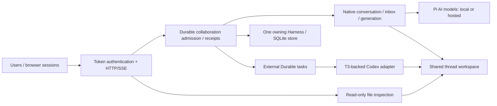

# Presentation and evaluator walkthrough

**Status, November 9, 2026:** local collaborative Pi Durable works with actual Ollama inference,
and the user has confirmed OpenAI works. A reproducible hosted-provider/recovery report, real
Codex turn/continuation and GCP deployment remain outstanding. Use [progress](TAKE_HOME_PROGRESS.md) for exact evidence
and [the deployment runbook](apps/collab-demo/deploy/README.md) for prepared, uninstalled templates.

## Slide deck and speaker notes

The [Moloch/Beamer presentation](presentations/take-home/README.md) contains 12 main slides and four
backup slides, with 8 minutes 30 seconds of planned cues. Allow roughly 8–10 minutes with model
latency; human rehearsal remains pending. Outputs include [PowerPoint](presentations/take-home/output/collaborative-pi-durable.pptx),
[slide PDF](presentations/take-home/output/collaborative-pi-durable.pdf), and a
[speaker-note handout](presentations/take-home/output/speaker-notes.pdf).

Each slide's [notes](presentations/take-home/speaker-notes.md) give speaking points, suggested
demonstrations, a fallback, a boundary to state and wiki/source links. GCP demonstrations are
explicitly planned for after deployment. The included screenshot is a recorded local Ollama run.
The PPTX preserves the compiled LaTeX appearance as images with editable notes; change visual
content in [slides.tex](presentations/take-home/slides.tex) and rebuild using the deck README.

## Eight-minute outline

| Time | Show / explain | Limit to state |
| --- | --- | --- |
| 0:00–0:45 | Problem: multiple users instruct shared coding agents in one workspace; explain why this fork extends Durable itself | Shared access does not reconcile contradictory human intent |
| 0:45–2:00 | [Package API](packages/durable/README.md#collaborative-threads): one thread/store, named lanes, membership, receipt identity, existing transactions/tasks | Authentication and browser delivery are host-owned; Chord remains internally |
| 2:00–3:30 | Alice and Bob both use both agents; show attributed inputs, same-lane queue and peer observation | Separate histories; the local backend serializes inference even though lanes are independent |
| 3:30–4:30 | Create distinct files, inspect actual text through **Workspace files · Read only**, then refresh after a follow-up edit | Current bytes, not a diff/checkpoint or atomic snapshot; shared writes remain unprotected |
| 4:30–5:30 | Lost-response retry contract, reconnect and restart evidence; contrast native recovery with uncertain external interruption | One receipt may span repeated native model requests; no exactly-once shell effects |
| 5:30–6:30 | [Measured report](apps/collab-demo/load/README.md): burst capacity refusal and 600.89-second soak | Simulated execution over real SQLite/HTTP/SSE; not real Codex throughput or a memory bound |
| 6:30–7:15 | Single owner/process/VM failure domain; prepared GCP service, backup/access/teardown design | No deployed VM or verified Linux containment/restore yet |
| 7:15–8:00 | Explain T3 reuse and the selected next steps, with alternatives and costs | General file coordination, richer approvals and framework replacement are extensions |

## Architecture to point at



Core source anchors: [admission](packages/durable/src/collaboration/thread.ts),
[external execution](packages/durable/src/collaboration/external.ts),
[contracts](packages/durable/src/collaboration/types.ts),
[T3 provenance](packages/durable/src/adapters/codex/vendor/UPSTREAM.md),
[host composition](apps/collab-demo/src/main.ts), and
[file inspection](apps/collab-demo/src/workspace-files.ts).

## Prepare the live local demo

Use the installed local runtime/model described in [LOCAL_MODELS.md](apps/collab-demo/LOCAL_MODELS.md).
From `E:\Github\pi`, terminal 1:

```powershell
& .\apps\collab-demo\scripts\start-ollama.ps1
```

Terminal 2:

```powershell
. .\.artifacts\env.ps1
Set-Location apps/collab-demo
$env:COLLAB_CONFIG = 'config.ollama.example.json'
$env:COLLAB_DATA = 'data/presentation'
$env:COLLAB_TOKEN_ALICE = node -p "require('node:crypto').randomBytes(24).toString('base64url')"
$env:COLLAB_TOKEN_BOB = node -p "require('node:crypto').randomBytes(24).toString('base64url')"
npm run build
npm run preflight
npm start
```

Open `http://127.0.0.1:4310` in two tabs/profiles. Paste each generated token locally into its
page; tokens remain in page memory. Use a fresh data directory if the fixed configuration has
changed; do not delete or repurpose an existing store. `npm run preview` instead uses simulated
agents, port 4311 and disposable files. Label that fallback explicitly.
Workspace packages must already be built; on a fresh checkout follow the
[environment setup](TAKE_HOME_ENVIRONMENT.md) and run the root offline build first.
Preflight checks configuration/assets/key presence; it does not contact Ollama or prove model access.
Alternatively, save these settings once in the ignored `apps/collab-demo/.env`; start and preflight
load it automatically. The shown terminal variables override file values, allowing this local
walkthrough to run even when `.env` selects hosted agents. Codex login is cached separately.

The persistent live workspace appears after startup under
`apps/collab-demo/data/presentation/workspace/`; its sibling `thread.sqlite` stores history/receipts.
The separate integration smoke uses disposable storage, so its successful run does not leave
these presentation files behind.

## Suggested interaction trace

1. Alice → `local-a`: **Use the write tool once to create alice.txt containing exactly ALICE-ONE. Then reply DONE.**
2. While it is busy, Bob → `local-a`: **Use the edit tool once on alice.txt to replace ALICE-ONE with ALICE-TWO. Then reply DONE.** Show that this input queues.
3. Bob → `local-b`: **Use the write tool once to create bob.txt containing exactly BOB-ONE. Then reply DONE.**
4. Open the file panel in both pages. Inspect the final file bytes: `ALICE-TWO` and `BOB-ONE`.
5. Alice → `local-b`: **Use the read tool on bob.txt, then reply with only its contents.** This completes all four user/agent pairings.
6. Bob → `local-b`: **Use the write tool once to replace bob.txt with exactly BOB-TWO. Then reply DONE.** Refresh the selected file to inspect the change.
7. Refresh/reconnect Alice's page and sign in again if it reloaded. Show restored committed messages without submitting another instruction. Reload loses ambiguous local retry drafts; do not demonstrate an ambiguous retry by inventing a new ID.

Small models can make redundant calls or describe tool problems despite reaching the requested
file state. Inspect the actual file. Completed status means the agent turn ended, not that an
arbitrary coding task passed tests. If a model misbehaves, show the limitation rather than
silently weakening the expected output or claiming the deterministic fallback is live inference.

For a host restart, wait until both lanes are idle, stop only this host with Ctrl+C, and restart
it with the same environment/data directory. Reconnect/relogin and inspect files/history. This
is a graceful idle restart demonstration, not active shell takeover or power-loss certification.

## Evidence and claims

| Evidence | What it supports |
| --- | --- |
| [Real browser report](apps/collab-demo/scripts/results/2026-11-08-ollama-browser.json) | Normal `main.ts` host, actual local model, two page identities, five completed commands, four pairings, real file outcomes, offline/reconnect, idle shutdown/reopen and stable receipt retry |
| [Earlier local tool smoke](apps/collab-demo/scripts/results/2026-11-08-ollama.json) | Four independent tool-written files, receipt retry and graceful SQLite reopen with read/write-only tools |
| [Risk register](apps/collab-demo/PROBLEM_SCENARIOS.md) | Tested behavior, partial protections and explicit gaps; no implied conflict-free arbitrary writes |
| [Managed-file example 41](packages/durable/test/examples/41-managed-file-conflict.ts) | Optional stale rejection and retained conflicts; no agent/UI integration |
| [Load report](apps/collab-demo/load/README.md) | 20 baseline + 81 burst + 1200 soak completions, 519 intentional burst rejections, 30 stable retry probes |
| [Recovery contract](packages/durable/docs/collaboration.md#recovery-and-external-effects) | Exact forced-kill/storage-fault boundaries and their limits |

The real browser check recorded five commands and eleven model requests in 30.772 seconds,
including backend/browser startup and an idle host reopen. It is one integration run, not a
throughput benchmark. An ad-hoc IPC preload delivered the host's SIGTERM event for Windows QA;
the ordinary host handled cleanup. No active-shell stop or escaped descendant containment was tested.
Local screenshots/report remain in ignored `.artifacts/ollama-browser-*`; only the redacted,
portable JSON report is tracked. Temporary processes, profile and data were removed afterward.

The local presentation configuration also passed read-only preflight on November 8, without
creating a data directory or contacting a model. This validates setup prerequisites, not human
presentation timing or hosted/Codex access.

## Likely reviewer questions

- **Why extend Durable?** The assignment asks for a version of it. Reusing its transaction line,
  native inbox and tasks avoids an application-owned scheduler or second persistence engine.
- **What did T3 contribute?** Actual vendored typed Codex client/protocol/replay code, isolated
  behind an external-driver contract and explicit adapter subpath; provenance/licenses are retained.
- **What if both agents edit one file?** Same-lane ordering and individual native edit/write
  serialization do not protect a whole cross-agent read/modify/write turn. Lost updates remain
  reproducible; managed publication or whole-turn ownership are separate options.
- **What happens after a crash?** Native generation uses existing recovery. Uncertain external
  dispatch is interrupted without automatic resend. File effects and SQLite are not one transaction.
- **Why one owner?** Fits the take-home budget; ownership/process/disk are single failure domains.
  Multiple workers require fenced ownership and workspace/process isolation, not a second process
  opening the same store.
- **Where can writes bottleneck?** Admission and external progress share one metadata document.
  External progress is stored immediately under the core scope rule, despite its deferred option.
  A future measured optimization can coalesce progress in an eligible conversation document;
  that needs projection/recovery tests and is outside this delivery increment.
- **Where is the contract?** [Specification section 14](packages/durable/docs/spec.md#14-collaborative-threads-in-this-fork)
  integrates the fork's rules with core transactions, tasks, submissions and watches. The
  [addendum](packages/durable/docs/collaboration.md) expands API details and evidence.
- **What is unfinished?** Human rehearsal, real hosted native/Codex
  turns, real/Linux containment and actual GCP deployment/backup restoration. The cloud kit is preparation.

## Immediate next work and access gates

1. Rehearse this walkthrough and record human presentation timing. Specification integration
   is complete; the outlined eight minutes is a target, not a measured rehearsal. No provider
   key or GCP project is needed for local rehearsal.
2. Verify a real hosted native lane and the configured external Codex lane when private OpenAI
   credentials and Codex authentication are available. Local Ollama evidence does not establish them.
3. After readiness, select the GCP project/access and perform the documented Linux deployment,
   containment, restart/reboot, backup/restore and evaluator-access checks. No resources are provisioned yet.

Do not expand to new UI features or broad file coordination merely to fill these access-dependent
gaps. Keep the user's deferred Windows Bash investigation explicit and preserve the original time budget.
