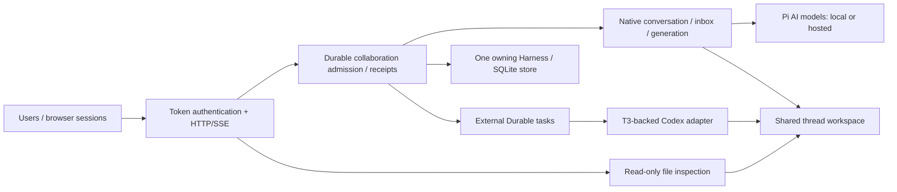

# Presentation and evaluator walkthrough

**Status, November 10, 2026:** the conflict GUI, bounded native activity feed and refreshed
agent collaboration context are implemented. The deck now leads with a two-user handoff and keeps
the conflict problem beside its demonstration. Cloud website access is user-reported; the current
deployed revision, slow GCP Ollama chat, real Codex turns and operational acceptance still need
verification. See [progress](TAKE_HOME_PROGRESS.md) and the [collaboration explanation](llm-wiki/10-collaboration-awareness.md).

## Slide deck and speaker notes

The [Moloch/Beamer deck](presentations/take-home/README.md) has **14 main slides and four backups**,
with ten minutes of planned cues. Current outputs: [revised PowerPoint](presentations/take-home/output/collaborative-pi-durable-revised.pptx),
[slide PDF](presentations/take-home/output/collaborative-pi-durable-revised.pdf) and
[speaker-note handout](presentations/take-home/output/speaker-notes-revised.pdf).

Each slide's [notes](presentations/take-home/speaker-notes.md) use short speaking points with
examples and optional technical details beneath them. Brackets explain unfamiliar terms where
used, including external harness [separate agent application]. Numbered demo steps, fallback,
limits, transitions and wiki/source links follow. PowerPoint notes are editable; slide visuals
are compiled LaTeX images. Change the LaTeX/JSON sources and rebuild using `--output-suffix=-revised`.
The historical screenshot shows local Ollama, not the exact new handoff or a GCP run. Earlier
unsuffixed outputs remain available for comparison.

## Ten-minute outline

| Slides | Show / explain | Limit to state |
| --- | --- | --- |
| 1–3 | Alice starts work; Bob sees and continues it on the same agent; Ollama can review the same files | Human coordination and shared control distinguish this from private agent sessions |
| 4–6 | Package boundaries, saved requests versus model answers, visible activity and file inspection | Same-ID retry differs from new Send; completion does not establish code correctness |
| 7–8 | Lost-update trace immediately followed by generate/publish/refuse/resolve/reset | Destination checks protect managed proposals, not ordinary coding writes or dependencies |
| 9 | Peer awareness, rereading and context overhead | Guidance does not enforce edit safety or establish file authorship |
| 10–12 | Recovery, T3 reuse, controlled/live/load evidence | No universal exactly-once effects or real Codex turn claim |
| 13–14 | Cloud website access, pending acceptance and next protection slice | Access is user-reported; latest revision, latency, containment and restore need verification |

Timing is a rehearsal target. Use the conflict GUI as the main interactive proof; shorten the
native model run if latency makes it unpredictable. Never race live models to force a conflict.

Before presenting slide 8, generate both proposals in the same round if model latency would
interrupt the talk. Disclose this preparation, then demonstrate publication/refusal/resolution
and Reset live. Generating a proposal has already finished by the time a user resolves it;
the model is not paused awaiting resolution, and no automatic continuation is implemented.

Slide 2 uses a workflow rather than an access matrix: Bob sees Alice's instruction and sends a
follow-up into the same conversation/queue, while another agent has separate history but sees
the shared files. Both users can inspect or stop shared work. Equal access is the current
trusted-team policy; different permissions would be a separate feature.

## Architecture to point at



Core source anchors: [admission](packages/durable/src/collaboration/thread.ts),
[external execution](packages/durable/src/collaboration/external.ts),
[contracts](packages/durable/src/collaboration/types.ts),
[T3 provenance](packages/durable/src/adapters/codex/vendor/UPSTREAM.md),
[host composition](apps/collab-demo/src/main.ts), and
[file inspection](apps/collab-demo/src/workspace-files.ts).

## Prepare the live local demo

Use the installed local runtime/model described in [LOCAL_MODELS.md](apps/collab-demo/LOCAL_MODELS.md).
From `E:\Github\pi`, terminal 1:

```powershell
& .\apps\collab-demo\scripts\start-ollama.ps1
```

Terminal 2:

```powershell
. .\.artifacts\env.ps1
Set-Location apps/collab-demo
$env:COLLAB_CONFIG = 'config.ollama.example.json'
$env:COLLAB_DATA = 'data/presentation'
$env:COLLAB_TOKEN_ALICE = node -p "require('node:crypto').randomBytes(24).toString('base64url')"
$env:COLLAB_TOKEN_BOB = node -p "require('node:crypto').randomBytes(24).toString('base64url')"
npm run build
npm run preflight
npm start
```

Open `http://127.0.0.1:4310` in two tabs/profiles. Paste each generated token locally into its
page; tokens remain in page memory. Use a fresh data directory if the fixed configuration has
changed; do not delete or repurpose an existing store. `npm run preview` instead uses simulated
agents, port 4311 and disposable files. Label that fallback explicitly.
Workspace packages must already be built; on a fresh checkout follow the
[environment setup](TAKE_HOME_ENVIRONMENT.md) and run the root offline build first.
Preflight checks configuration/assets/key presence; it does not contact Ollama or prove model access.
Alternatively, save these settings once in the ignored `apps/collab-demo/.env`; start and preflight
load it automatically. The shown terminal variables override file values, allowing this local
walkthrough to run even when `.env` selects hosted agents. Codex login is cached separately.

The persistent live workspace appears after startup under
`apps/collab-demo/data/presentation/workspace/`; its sibling `thread.sqlite` stores history/receipts.
The separate integration smoke uses disposable storage, so its successful run does not leave
these presentation files behind.

## Suggested interaction trace

For the short slide-3 handoff, use the current default OpenAI/Ollama configuration: Alice asks
OpenAI to create `handoff.txt` containing `DRAFT`; Bob observes the attributed request and asks
the same agent to replace it with `REVIEWED`. Both inspect the file. If rehearsed latency permits,
Bob asks Ollama to read it. This demonstrates one person continuing another person's work without
copying a transcript. The longer local-only trace below exercises all four pairings for preparation.

1. Alice → `local-a`: **Use the write tool once to create alice.txt containing exactly ALICE-ONE. Then reply DONE.**
2. While it is busy, Bob → `local-a`: **Use the edit tool once on alice.txt to replace ALICE-ONE with ALICE-TWO. Then reply DONE.** Show that this input queues.
3. Bob → `local-b`: **Use the write tool once to create bob.txt containing exactly BOB-ONE. Then reply DONE.**
4. Open the file panel in both pages. Inspect the final file bytes: `ALICE-TWO` and `BOB-ONE`.
5. Alice → `local-b`: **Use the read tool on bob.txt, then reply with only its contents.** This completes all four user/agent pairings.
6. Bob → `local-b`: **Use the write tool once to replace bob.txt with exactly BOB-TWO. Then reply DONE.** Refresh the selected file to inspect the change.
7. Refresh/reconnect Alice's page and sign in again if it reloaded. Show restored committed messages without submitting another instruction. Reload loses ambiguous local retry drafts; do not demonstrate an ambiguous retry by inventing a new ID.

Small models can make redundant calls or describe tool problems despite reaching the requested
file state. Inspect the actual file. Completed status means the agent turn ended, not that an
arbitrary coding task passed tests. If a model misbehaves, show the limitation rather than
silently weakening the expected output or claiming the deterministic fallback is live inference.

For a host restart, wait until both lanes are idle, stop only this host with Ctrl+C, and restart
it with the same environment/data directory. Reconnect/relogin and inspect files/history. This
is a graceful idle restart demonstration, not active shell takeover or power-loss certification.

## Evidence and claims

| Evidence | What it supports |
| --- | --- |
| [Real browser report](apps/collab-demo/scripts/results/2026-11-08-ollama-browser.json) | Normal `main.ts` host, actual local model, two page identities, five completed commands, four pairings, real file outcomes, offline/reconnect, idle shutdown/reopen and stable receipt retry |
| [Earlier local tool smoke](apps/collab-demo/scripts/results/2026-11-08-ollama.json) | Four independent tool-written files, receipt retry and graceful SQLite reopen with read/write-only tools |
| [Risk register](apps/collab-demo/PROBLEM_SCENARIOS.md) | Tested behavior, partial protections and explicit gaps; no implied conflict-free arbitrary writes |
| [Managed-file example 41](packages/durable/test/examples/41-managed-file-conflict.ts) | Stale rejection and retained conflicts; scripted GUI integrated, ordinary agents remain outside it |
| [Load report](apps/collab-demo/load/README.md) | 20 baseline + 81 burst + 1200 soak completions, 519 intentional burst rejections, 30 stable retry probes |
| [Recovery contract](packages/durable/docs/collaboration.md#recovery-and-external-effects) | Exact forced-kill/storage-fault boundaries and their limits |

The real browser check recorded five commands and eleven model requests in 30.772 seconds,
including backend/browser startup and an idle host reopen. It is one integration run, not a
throughput benchmark. An ad-hoc IPC preload delivered the host's SIGTERM event for Windows QA;
the ordinary host handled cleanup. No active-shell stop or escaped descendant containment was tested.
Local screenshots/report remain in ignored `.artifacts/ollama-browser-*`; only the redacted,
portable JSON report is tracked. Temporary processes, profile and data were removed afterward.

The local presentation configuration also passed read-only preflight on November 8, without
creating a data directory or contacting a model. This validates setup prerequisites, not human
presentation timing or hosted/Codex access.

## Likely reviewer questions

- **Why extend Durable?** The assignment asks for a version of it. Reusing its transaction line,
  native inbox and tasks avoids an application-owned scheduler or second persistence engine.
- **What did T3 contribute?** Actual vendored typed Codex client/protocol/replay code, isolated
  behind an external-driver contract and explicit adapter subpath; provenance/licenses are retained.
- **What if both agents edit one file?** Same-lane ordering and individual native edit/write
  serialization do not protect a whole cross-agent read/modify/write turn. Lost updates remain
  reproducible; managed publication or whole-turn ownership are separate options.
- **What happens after a crash?** Native generation uses existing recovery. Uncertain external
  dispatch is interrupted without automatic resend. File effects and SQLite are not one transaction.
- **Why one owner?** Fits the take-home budget; ownership/process/disk are single failure domains.
  Multiple workers require fenced ownership and workspace/process isolation, not a second process
  opening the same store.
- **Where can writes bottleneck?** Admission and external progress share one metadata document.
  External progress is stored immediately under the core scope rule, despite its deferred option.
  A future measured optimization can coalesce progress in an eligible conversation document;
  that needs projection/recovery tests and is outside this delivery increment.
- **Where is the contract?** [Specification section 14](packages/durable/docs/spec.md#14-collaborative-threads-in-this-fork)
  integrates the fork's rules with core transactions, tasks, submissions and watches. The
  [addendum](packages/durable/docs/collaboration.md) expands API details and evidence.
- **What is unfinished?** Human rehearsal, reproducible hosted native/Codex turns,
  verification of updated GCP features, GCP Ollama latency, Linux containment and backup restoration.
  User-reported website access does not establish these properties.

## Controlled conflict and awareness demonstrations

1. Use two authenticated browser identities on a fresh isolated presentation store. Open
   **Shared-file conflict · Controlled demonstration** in both pages.
2. Both choose a native model, edit their prompt and select **1. Generate my proposal**. Inspect generated output before publishing. Alice selects **2. Publish my edit**, then Bob does the
   same. Show the refused stale proposal and retained original/current/proposed contents.
3. Bob enters combined resolution text and selects **3. Publish my resolution**. Inspect the
   resulting file in both pages. This is explicit resolution, not automatic merging.
4. Select **Reset round for both users** to restore default prompts and neutral file contents.
   Old-round actions are refused; previous evidence is retained up to 64 rounds, and live coding files stay intact. Example 41
   remains a terminal fallback with its own temporary files and no model/server dependency.
5. For awareness, rehearse separately with a disposable file: Ollama writes blue, GPT changes
   it to green, then Ollama rereads and describes the current file without restoring blue.
   The prompt supplies peer awareness, not proof of who wrote the file. Model compliance is
   still to be verified; it does not replace managed publication checks.

## Immediate next work and access gates

1. Rehearse the updated deck and real OpenAI/Ollama peer-edit trace; record timing and actual
   file outcomes. Scripted GUI rehearsal needs no keys; live native checks use existing access.
2. Next protection slice: trusted-context managed model tools and file-effect provenance,
   with an explicit policy for ordinary shell/external bypass writes and uncertain publication.
3. Deploy the updated revision and verify the chosen GCP access route, Linux cleanup and
   backup restoration. Real Codex coding/continuation requires separate authentication.

Keep worktrees, automatic merge, multi-file transactions, roles/approvals and distributed workers
as extensions. Preserve the user's deferred Windows Bash investigation and the take-home scope.
