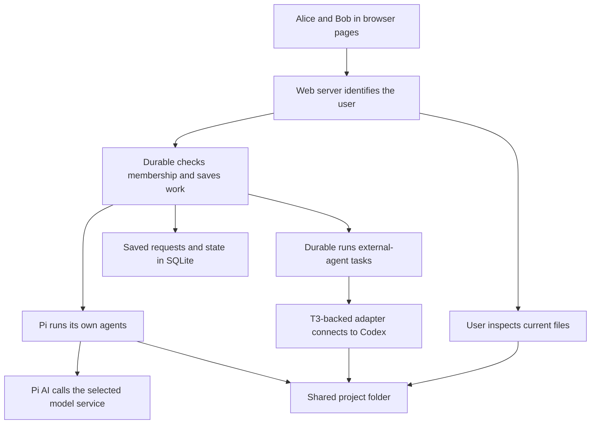

# Architecture and project map

This project adds shared-agent behavior to Pi Durable, which already knows how to save and run agent work. The web app lets people use that behavior, while the main rules stay in the reusable library.

The most useful source entry points are the [collaboration contract](../packages/durable/docs/collaboration.md), [specification section 14](../packages/durable/docs/spec.md#14-collaborative-threads-in-this-fork), and [demo composition](../apps/collab-demo/src/main.ts). These connect the public behavior to the existing Pi packages. For unfamiliar names, see [provider versus harness](09-technical-terms.md#provider-model-agent-harness-and-adapter) and [thread versus Session](09-technical-terms.md#thread-conversation-lane-session-and-harness).

## What the assignment actually asks for

Several people should be able to talk to several coding agents, with agents working in a shared project folder. The assignment also asks for stress testing, investigation of failure cases, and deployment to GCP; it suggests using T3 Code where helpful.

This scope is larger than making a chat interface or launching two LLM requests. It requires decisions about identity, ordering, persistence, cancellation and filesystem effects. The implementation addresses collaboration inside the Durable fork and supplies local evidence and deployment preparation; actual cloud delivery remains unfinished. The original approximately twenty-hour budget explains prioritizing one owner, fixed membership and narrow protections over a general collaboration platform. [Assignment](../PROJECT_INSTRUCTIONS.txt), [implementation plan](../TAKE_HOME_IMPLEMENTATION_PLAN.md).

## How the existing packages fit together

Pi AI talks to model services such as OpenAI, and Pi Durable saves conversations and runs agent work. The new collaboration code adds shared users and agents, while the demo turns those capabilities into a web app.

For example, when Alice asks an agent to create a file, the web app identifies Alice, the collaboration library checks her membership, Durable runs the work, and Pi AI sends requests to the selected model. Chord is an existing library Durable uses to update and observe saved structured state. The existing coding-agent package supplies related coding-tool designs; we did not rebuild its entire terminal application or invent the model providers, file tools, or SQLite storage.

| Existing part | Responsibility in this project |
| --- | --- |
| [Pi AI](../packages/ai/README.md) | Models, credentials, streaming and provider request translation |
| [Pi Durable](../packages/durable/README.md) | Session commits, conversations, tasks, inboxes, tools, storage and recovery |
| [Chord](../packages/chord/README.md) | Tracked JSON state, operations and watch infrastructure |
| [Coding agent](../packages/coding-agent/README.md) | Existing interactive agent implementation and related coding-tool designs |
| [Collaboration module](../packages/durable/src/collaboration/index.ts) | Thread membership, attributed admission, receipts, external work and lane projections |
| [Demo host](../apps/collab-demo/README.md) | Authentication, configuration, HTTP/SSE, browser and file inspection |

## Vocabulary to explain accurately

A **thread** is one shared project with its members, named agents, and workspace folder. Each agent has its own conversation and queue, so Alice and Bob share agent A's history while agent B keeps a separate history.

Durable calls its saved-state manager a **Session** and the machinery running work over it a **Harness**. A **command** is a user's request; a native **submission** is that request's place in an agent's inbox; a **task** is work with saved steps that the scheduler can revisit. A **tool call** is an operation such as reading a file, and a **turn** is a model/tool interaction whose exact scope depends on the API. A **lane** is simply the UI's name for one agent and its queue, not a separate CPU or necessarily a separate process. See [core concepts](../packages/durable/README.md#concepts).

## Why the feature lives inside Durable

If the web server saved requests separately from Durable, it could crash between accepting a request and handing it over. Saving the request and the information needed to run it together in Durable avoids that gap and lets other interfaces reuse the same behavior.

For example, accepting Alice's message in an HTTP queue and later submitting it to Durable creates a crash boundary between two systems. Here, the receipt and executable intent are admitted together on Durable's transaction line. The web host can be replaced by another transport while retaining package behavior, as demonstrated by the standalone examples. This is separation of responsibilities, not complete independence from Chord or other frameworks. [Thread implementation](../packages/durable/src/collaboration/thread.ts), [example 38](../packages/durable/test/examples/38-collaborative-thread.ts).

## Runtime versus host responsibility

The web server checks who the user is; the collaboration library checks whether that user belongs to the thread and what work can be accepted. The browser shows the results, but does not control the agent's queue or recovery rules.

For example, the server maps Alice's login token to `actorId: alice`; the package then checks Alice against the thread's saved membership. This separates **authentication** (who are you?) from **authorization** (what may you do?). HTTP input checks, connection limits, browser rendering, and the read-only file viewer stay in the host. Neither this split nor a valid login isolates agent tools from the computer they run on. See [server](../apps/collab-demo/src/server.ts) and [startup policy](../apps/collab-demo/src/startup.ts).

## What was added and what was reused

We added the rules for sharing agents, recording each user's requests, connecting external agents, and showing the work in a browser. Durable already supplied the saving, scheduling, model calls, and native coding tools underneath those additions.

The main additions are [thread admission](../packages/durable/src/collaboration/thread.ts), [external execution](../packages/durable/src/collaboration/external.ts), [metadata](../packages/durable/src/collaboration/state.ts), [views](../packages/durable/src/collaboration/view.ts), the [managed-file experiment](../packages/durable/src/collaboration/managed-file.ts), the Codex adapter and demo. Existing Session transactions, native generation, tools, storage and scheduler remain underneath. This is a useful answer to “What was your contribution?” without taking credit for the entire upstream project.

## Framework dependence and the alternative approach

We chose to build on Durable's existing internals rather than replace them before producing a working prototype. The code separates external-agent connections from the general collaboration interface, which helps future changes, but the project still depends on its existing frameworks.

Chord remains part of Durable, and the optional Codex adapter uses Effect/platform dependencies. A later approach could replace scheduling/storage internals behind the collaboration contract, but that is a larger redesign with persistence compatibility implications. It would need behavioral parity tests and a deliberate store migration strategy or fresh stores. Do not describe an isolated adapter import as proof that the whole runtime is framework-independent. [Package exports](../packages/durable/package.json), [design decisions](../TAKE_HOME_PROGRESS.md#decisions-and-trade-offs).
