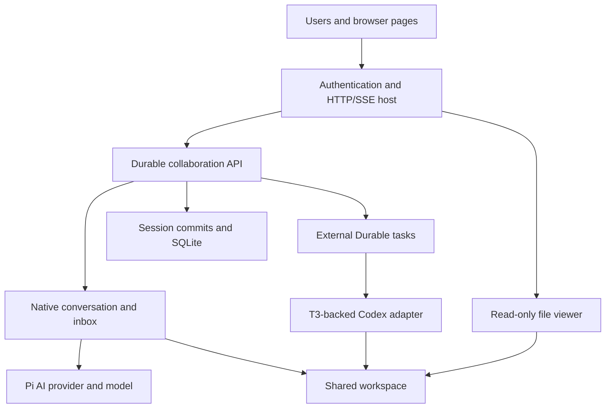

# Architecture and project map

The project extends an existing durable agent runtime with collaboration rather than rebuilding that runtime in a web server. Understanding which layer owns each guarantee is the foundation for explaining the implementation.

The most useful source entry points are the [collaboration contract](../packages/durable/docs/collaboration.md), [specification section 14](../packages/durable/docs/spec.md#14-collaborative-threads-in-this-fork), and [demo composition](../apps/collab-demo/src/main.ts). These connect the public behavior to the existing Pi packages.

## What the assignment actually asks for

The assignment asks for a version of Pi Durable supporting multiple people interacting with multiple coding agents, with a shared filesystem within a thread. It also asks for stress testing, failure/hotspot analysis and GCP deployment; T3 reuse is an available implementation resource.

This scope is larger than making a chat interface or launching two LLM requests. It requires decisions about identity, ordering, persistence, cancellation and filesystem effects. The implementation addresses collaboration inside the Durable fork and supplies local evidence and deployment preparation; actual cloud delivery remains unfinished. The original approximately twenty-hour budget explains prioritizing one owner, fixed membership and narrow protections over a general collaboration platform. [Assignment](../PROJECT_INSTRUCTIONS.txt), [implementation plan](../TAKE_HOME_IMPLEMENTATION_PLAN.md).

## How the existing packages fit together

Pi AI provides model/provider access, while Pi Durable adds persistent conversations, tasks, submissions and recovery. Chord supplies document state operations and observation machinery used by Durable; the demo exposes these capabilities through HTTP and a browser.

The coding-agent package is a broader existing interactive coding product and a source of reusable concepts; this assignment does not replace its entire terminal application. Durable already has coding tools ported from that harness, and this work composes those tools through Durable's execution environment. Avoid presenting the native tool system, SQLite backend or model-provider implementations as newly invented collaboration code.

| Existing part | Responsibility in this project |
| --- | --- |
| [Pi AI](../packages/ai/README.md) | Models, credentials, streaming and provider request translation |
| [Pi Durable](../packages/durable/README.md) | Session commits, conversations, tasks, inboxes, tools, storage and recovery |
| [Chord](../packages/chord/README.md) | Tracked JSON state, operations and watch infrastructure |
| [Coding agent](../packages/coding-agent/README.md) | Existing interactive agent implementation and related coding-tool designs |
| [Collaboration module](../packages/durable/src/collaboration/index.ts) | Thread membership, attributed admission, receipts, external work and lane projections |
| [Demo host](../apps/collab-demo/README.md) | Authentication, configuration, HTTP/SSE, browser and file inspection |

## Vocabulary to explain accurately

A Session owns one atomic mutation line and persistent records, while a Harness adds the machinery that runs agent work over that Session. A collaborative thread organizes members, named agents and their shared workspace over one Harness/store.

A conversation is one agent's transcript and configuration scope; a command is a user's attributed request to a named agent. Native input becomes a submission, which tracks whether it is queued, placed or answered. A task is a persistent state machine, while a tool call performs an operation such as reading or editing a file. A native run can include several model/tool turns, so a turn, command, task and process are different units. A “lane” in the demo means a named agent with its history and queue, not a dedicated CPU or necessarily a separate process. [Core concepts](../packages/durable/README.md#concepts).

## Why the feature lives inside Durable

Putting admission and execution in Durable makes collaboration usable without the browser and gives it the same persistence rules as ordinary agent work. The alternative of a web-owned queue/database would duplicate ordering, recovery and status machinery.

For example, accepting Alice's message in an HTTP queue and later submitting it to Durable creates a crash boundary between two systems. Here, the receipt and executable intent are admitted together on Durable's transaction line. The web host can be replaced by another transport while retaining package behavior, as demonstrated by the standalone examples. This is separation of responsibilities, not complete independence from Chord or other frameworks. [Thread implementation](../packages/durable/src/collaboration/thread.ts), [example 38](../packages/durable/test/examples/38-collaborative-thread.ts).

## Runtime versus host responsibility

Durable enforces membership and execution rules using a host-supplied identity; the host authenticates that identity and delivers state to clients. Neither layer alone is a complete hosted product or security boundary.

The HTTP host maps a bearer token to Alice and passes `actorId` to the package. The package decides whether Alice belongs to the stored thread and whether admission fits its limits. JSON validation, HTTP error codes, socket buffers and browser rendering remain transport concerns. File inspection is also host functionality; it reads the configured workspace after authorization and does not change agent write semantics. [Server](../apps/collab-demo/src/server.ts), [startup policy](../apps/collab-demo/src/startup.ts).

## What was added and what was reused

The new work supplies collaboration policy and adapter/host integration around existing runtime mechanisms. Reuse reduces implementation size, but it also means inherited semantics must be understood rather than replaced with stronger promises.

The main additions are [thread admission](../packages/durable/src/collaboration/thread.ts), [external execution](../packages/durable/src/collaboration/external.ts), [metadata](../packages/durable/src/collaboration/state.ts), [views](../packages/durable/src/collaboration/view.ts), the [managed-file experiment](../packages/durable/src/collaboration/managed-file.ts), the Codex adapter and demo. Existing Session transactions, native generation, tools, storage and scheduler remain underneath. This is a useful answer to “What was your contribution?” without taking credit for the entire upstream project.

## Framework dependence and the alternative approach

The chosen approach extends Durable while keeping generic collaboration contracts separate from adapter-specific types. It improves the boundary for later replacement without removing the runtime's framework dependencies today.

Chord remains part of Durable, and the optional Codex adapter uses Effect/platform dependencies. A later approach could replace scheduling/storage internals behind the collaboration contract, but that is a larger redesign with persistence compatibility implications. It would need behavioral parity tests and a deliberate store migration strategy or fresh stores. Do not describe an isolated adapter import as proof that the whole runtime is framework-independent. [Package exports](../packages/durable/package.json), [design decisions](../TAKE_HOME_PROGRESS.md#decisions-and-trade-offs).
