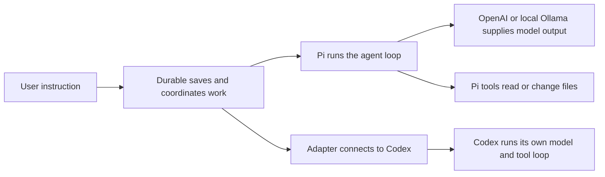
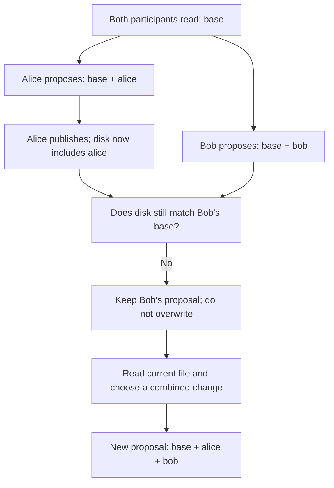

# Technical terms for explaining this project

This page explains the agent-system and collaboration terms used throughout the wiki. It assumes you know ordinary programming concepts, but have not operated a shared coding-agent service before.

Read the first paragraph of a section for the plain-English meaning, then the next paragraph for the engineering detail. The examples use Alice and Bob sharing agents A and B; the links lead to the actual implementation choices and interview questions. **A definition is not a delivery claim:** locks covering a whole instruction, automatic merging, distributed ownership, and the conflict GUI remain possible extensions where the linked pages say so.

## Find a term

Look up the word that blocks your understanding rather than memorizing this page in order. For interview preparation, start with harness, command, admission, idempotency, side effect, and stale edit.

The groups below follow a request from the model connection through shared work, failure recovery, and browser delivery. They deliberately omit basic programming vocabulary and focus on terms whose meaning or scope matters to this project.

| If you encounter… | Read this section |
| --- | --- |
| Provider, model, agent, harness, adapter, driver | [Who does what](#provider-model-agent-harness-and-adapter) |
| Thread, workspace, conversation, lane, Session, Harness | [How work is grouped](#thread-conversation-lane-session-and-harness) |
| Command, submission, turn, root turn, task, tool call | [Units of work](#command-submission-turn-task-and-tool-call) |
| Admission, executable intent, receipt, acknowledgement | [Accepting a request](#admission-receipt-and-acknowledgement) |
| Idempotency, deduplication, retry identity, exactly once | [Repeating a request](#idempotency-deduplication-and-exactly-once-claims) |
| Atomic commit, durability, mutation line | [What the database saves together](#atomic-commit-durability-and-the-mutation-line) |
| Concurrency, parallelism, serialization, ordering | [Taking turns](#concurrency-parallelism-and-serialization) |
| Lost update, stale context, optimistic concurrency, read set, ABA | [Outdated assumptions](#lost-updates-stale-context-and-optimistic-concurrency) |
| Base/current/proposed, publication, three-way merge | [Reviewing conflicting edits](#base-current-proposed-and-three-way-merge) |
| Branch, worktree, Git checkpoint, restore | [Separate working copies](#git-worktrees-checkpoints-and-restore) |
| Lock, ownership, lease, fencing | [Keeping writers apart](#locks-ownership-leases-and-fencing) |
| Side effect, checkpoint, dispatch marker, ambiguous outcome | [A crash during work](#side-effects-checkpoints-and-dispatch-markers) |
| State machine, terminal, settlement, reconciliation | [Interpreting saved progress](#state-machines-terminal-states-and-reconciliation) |
| Projection, snapshot, convergence, audit log, SSE, replay cursor | [What viewers receive](#projections-snapshots-sse-and-audit-logs) |
| Backpressure, fan-out, coalescing, bounded buffers | [A slow browser](#backpressure-fan-out-and-coalescing) |
| Continuation, context window, compaction | [Continuing a conversation](#continuation-context-windows-and-compaction) |
| Cancellation, deadline, graceful close, containment | [Stopping work](#cancellation-deadlines-and-process-containment) |
| Authentication, authorization, prompt injection, sandbox, TOCTOU | [Trust and access](#authentication-authorization-and-the-execution-boundary) |
| Single owner, failure domain, availability | [More processes or machines](#single-owner-failure-domain-and-availability) |
| WAL, sidecar, systemd, cgroup, supervision | [Storage and process operations](#sqlite-sidecars-and-linux-supervision) |
| Deterministic, barrier, fault injection, load, soak, p95, RSS | [Interpreting tests](#deterministic-tests-load-tests-and-measurements) |

## Provider, model, agent, harness, and adapter

A **provider** is the service you ask for model output, while a **model** is the selected model available through that service. An **agent** combines a model with instructions, conversation history, and tools; the **harness** is the software that runs that loop and manages its lifecycle.

For example, OpenAI is a provider and `gpt-5.4-mini` is the configured model; Pi runs agent A's loop of asking the model, performing requested tool calls, and returning tool results. **Harness engineering** is work on that surrounding system, including tool execution, saved context, cancellation, recovery, and controls over what the agent may do. An **adapter** or **driver** connects Durable to an external harness such as Codex, which runs its own tool loop; Ollama instead supplies model output to Pi. Two agents can use the same provider and model without sharing conversation history. [Provider overview](05-providers-adapters-and-trust.md), [same-key interview question](interview-questions/05-models-and-adapters.md#if-two-agents-use-the-same-openai-key-and-model-are-they-actually-the-same-agent).



The diagram shows two possible execution paths, not two harnesses involved in every request. The default OpenAI/Ollama demo uses the Pi path; Codex is a separate optional configuration.

## Thread, conversation, lane, Session, and Harness

A **thread** groups project members, named agents, and their shared **workspace**, meaning the folder where they work. Each agent has a **conversation**, its own message history and settings; the demo calls that agent's history and queue a **lane**.

Durable's capitalized **Session** manages saved records and coordinated state changes, while its **Harness** adds the machinery that runs work over that Session. These are specific Pi APIs, rather than synonyms for a browser session or the general word harness. In the current composition, the thread sits over one Harness/store: Alice and Bob share A's conversation, B has a separate conversation, and both agents see the same workspace. A lane does not imply its own process, CPU, or GPU. [Architecture vocabulary](01-architecture.md#vocabulary-to-explain-accurately).

## Command, submission, turn, task, and tool call

A **command** is one user's instruction to an agent, such as “create a README,” and a **tool call** is a concrete operation such as writing that file. A **submission** records native input waiting for or entering a conversation, a **task** records schedulable work, and a **turn** names an interaction cycle whose exact boundary depends on the agent API.

One command may trigger several model requests and tool calls. **Orchestration** is coordinating that work and its dependencies; **scheduling** decides which ready work runs when. Codex's **root turn** is the overall response cycle being tracked for the instruction; a completed file-tool item inside it is not the root turn's final outcome. A Durable task can also finish its orchestration job of recording a failed command. When asked whether “execution” completes or repeats, identify whether the interviewer means a command, a model request, a task, or an individual tool effect. [Adapter event handling](05-providers-adapters-and-trust.md#protocol-correctness-matters-beyond-spawning-a-cli), [task versus command](interview-questions/04-failures-and-recovery.md#how-can-a-durable-task-be-completed-while-the-users-command-is-failed-or-interrupted).

## Admission, receipt, and acknowledgement

**Admission** means checking a request and saving it as accepted work, while a **receipt** is the saved record used to recognize that accepted request later. An **acknowledgement** is the reply telling the caller that acceptance happened; it is not proof that the requested file change succeeded.

The **executable intent** is the saved information that tells Durable what work to run: native input or an external task. We save it with the receipt so a crash cannot leave an accepted receipt without its admitted work. If Alice's network reply disappears after the save, the receipt can still exist even though she saw no acknowledgement. HTTP `202` reports acceptance, and later command status reports the outcome. [Click-to-result trace](02-commands-and-concurrency.md#a-command-from-click-to-result).

## Idempotency, deduplication, and exactly-once claims

An **idempotent** operation can be repeated without adding another effect at the boundary it promises, and **deduplication** means recognizing repeat requests. Here, resending Alice's same request ID and text to the same agent returns the saved receipt rather than accepting a second command.

The complete **retry identity** includes thread, user, agent, and command ID; a new ID means new work, while the same identity with changed text is rejected. **Exactly once** promises one occurrence of the specified action; that is not our guarantee for every later effect, because a native model request can repeat and an arbitrary shell append might have happened before its result was saved. **At least once** promises one or more occurrences under its delivery/recovery assumptions, allowing duplicates; **at most once** allows zero or one, so work can be omitted. None describes the entire runtime without naming the action and assumptions. Our uncertain external-turn policy avoids automatic resend but can interrupt work that never reached Codex. [Worked repeated-action question](interview-questions/04-failures-and-recovery.md#if-one-instruction-is-accepted-could-recovery-call-the-model-twice-or-write-the-file-twice).

## Atomic commit, durability, and the mutation line

An **atomic commit** saves a group of database changes together, so they all take effect or none do. **Durability** concerns saved state surviving supported failures, while the **mutation line** is Durable's mechanism for handling those state changes one at a time.

For example, accepting Alice's request saves its receipt and work together. A later file write is outside that database transaction: keeping SQLite open while the model thinks would not make SQLite and the filesystem one all-or-nothing operation. Atomicity and durability answer different questions—whether a change is partial and whether a saved change survives—and neither means power-loss behavior has been tested on every storage device. [Transaction boundary](03-durability-and-recovery.md#what-the-atomic-transaction-actually-covers).

## Concurrency, parallelism, and serialization

**Concurrency** means work overlaps in time, such as B reading a file while A waits for a model; **parallelism** means work actually runs simultaneously on different execution resources. **Serialization** means selected operations take turns, but you must say which operations those are.

In this demo, requests to one agent run in order, database changes take turns, and some individual native file mutations are coordinated separately. Independent agents can still overlap their read/plan/write sequences, even with one JavaScript event loop. Conversely, two agents do not prove parallel GPU inference: our Ollama setup processes one model request at a time. “Serialized writes” therefore does not mean “no stale edits.” [Three forms of serialization](02-commands-and-concurrency.md#three-different-kinds-of-serialization).

## Lost updates, stale context, and optimistic concurrency

A **lost update** happens when Bob's replacement removes Alice's newer change because Bob worked from an old copy. That old assumption is **stale context**; **optimistic concurrency control** lets participants prepare edits independently, then checks their assumptions before applying them.

The managed-file API checks whether current content and file existence match the retained original. It rejects Bob's stale proposal and preserves it, but ordinary model tools do not use this API yet. A **read set** is the collection of files a plan depended on; checking only Bob's destination does not prove another dependency stayed unchanged. The **ABA problem** means content changed from A to B and back to A: exact content comparison cannot detect that history, while a trusted increasing revision could, if every relevant writer participated. [File protection and limits](04-files-and-conflicts.md#managed-publication-and-optimistic-concurrency-control).

## Base, current, proposed, and three-way merge

**Base** is what Bob originally read, **current** is what is on disk now, and **proposed** is what Bob wants to save. A **three-way merge** compares the base with both sets of changes to suggest a combined version; the current API preserves those inputs but does not perform that merge.

**Publication** means applying a proposal to the actual file after checking its base. In example 41, Alice publishes `base + alice`, Bob's `base + bob` conflicts, and a new proposal explicitly supplies `base + alice + bob`. That combination was chosen by the script, not discovered automatically. A future merge candidate would still need checking against the current file before publication, and a clean text merge would not prove the code makes sense. [Explicit resolution](04-files-and-conflicts.md#conflict-resolution-is-explicit-not-automatic-merging).



This is the cooperative managed-file example. It is not the behavior of arbitrary shell writes, nor an automatic merge by the live agents.

## Git worktrees, checkpoints, and restore

A Git **worktree** is a separate checked-out directory, so two agents can edit different working copies instead of immediately overwriting each other. A **checkpoint** preserves a known file state for later inspection or recovery, while **restore** changes files back toward a selected saved state.

A branch name alone does not give agents separate files if they still work in the same directory. Separate worktrees also mean B cannot immediately see A's unmerged edits, so the product needs an integration and review step. A checkpoint is useful evidence, not permission to reset a shared folder while someone else writes. These are future coordination options inspired partly by the T3 review; T3's prompt stashing saves message drafts rather than automatically protecting filesystem edits. [Git trade-offs and T3 findings](04-files-and-conflicts.md#what-git-contributes-and-what-it-does-not).

## Locks, ownership, leases, and fencing

A **lock** makes participating operations wait their turn, and **ownership** names who is allowed to act on a resource. A **lease** gives permission for a limited time; **fencing** prevents an old owner from continuing to act after ownership moves elsewhere.

For example, giving A the whole workspace until its instruction finishes could stop participating agents from planning against conflicting edits, but it would reduce concurrency. If A's lease expires while its shell is still writing, starting B creates a race unless that old writer is stopped or its writes are rejected. Database fencing tokens work only where the protected resource enforces them; an unrestricted filesystem write does not consult our database token. Whole-instruction ownership and distributed fencing are not implemented here. [Locking trade-off](interview-questions/03-file-conflicts.md#why-not-just-lock-the-workspace-until-an-agent-finishes-its-instruction), [multiple owners](interview-questions/08-scaling-and-operations.md#could-we-scale-by-starting-two-web-servers-against-the-same-thread-database-and-workspace).

## Side effects, checkpoints, and dispatch markers

A **side effect** is an action outside the saved coordination records, such as changing a file or launching a process. A **checkpoint** saves how far work got, while a **dispatch marker** specifically saves that an external attempt is about to be sent.

An **ambiguous outcome** means we cannot establish whether an action happened: Codex may have appended `hello` just before the host died without saving the result. Our external task writes its marker before send, then treats an unsettled attempt as interrupted after recovery instead of blindly sending it again. This can also abandon an unsent attempt, because the marker and Codex are not part of one shared transaction. A checkpoint records what we know, rather than making every external effect reversible or safe to retry. [Recovery policy](03-durability-and-recovery.md#why-uncertain-external-turns-are-not-automatically-resent).

```mermaid
sequenceDiagram
  participant D as Durable host
  participant S as SQLite
  participant C as External Codex
  participant F as Workspace file
  D->>S: Save dispatch marker
  D->>C: Send append hello instruction
  C->>F: Append hello
  Note over D,S: Host dies before saving outcome
  D->>S: Reopen and inspect marker
  Note over D,C: Unknown outcome: report interrupted; do not resend
```

The crash is a hypothetical ordering explaining the policy, not a claim that a real authenticated Codex crash test has run. Native model/tool recovery has its own policies, described in the [recovery overview](03-durability-and-recovery.md#native-recovery-is-intentionally-different).

## State machines, terminal states, and reconciliation

A **state machine** records which stage work is in and which stages may follow, such as queued, running, and completed. A **terminal** state means that particular piece of work has ended, not necessarily that the user's coding request succeeded.

**Settlement** records the command's final outcome; **reconciliation** interprets related records consistently when their last saved states disagree. For example, if an external task is already terminal but command metadata still says running, the public view derives interrupted rather than leaving it busy forever. It does not invent a successful result or repair all raw history. Likewise, a task can complete its job of recording a failed command, so task completion and command success are different facts. [Status reconciliation](03-durability-and-recovery.md#status-reconciliation-without-inventing-history).

## Projections, snapshots, SSE, and audit logs

A **projection** is a view calculated from underlying records, and a **snapshot** shows recent state rather than every step that produced it. **Server-Sent Events (SSE)** carry updates from the server to the browser; they do not by themselves make those updates a permanent history.

**Convergence** means the display catches up with underlying state as updates arrive; our separate command/conversation sources are not one atomic combined read. An **audit log** would retain the relevant facts in order, with a **replay cursor** identifying where a disconnected viewer should resume. Our current stream has no durable global replay cursor and may omit intermediate progress, while saved conversation history can be paged separately. Reconnecting Alice can therefore see completed work without receiving every token she missed. [Browser state contract](06-web-and-demonstration.md#snapshots-are-convergent-views-not-an-event-journal).

## Backpressure, fan-out, and coalescing

**Backpressure** is the problem of a producer sending faster than a consumer can read, such as a server updating a slow browser. **Fan-out** sends one source's updates to many viewers, while **coalescing** replaces older pending views with the latest one instead of keeping every update.

For example, Bob's blocked browser may have pending “running: step 2” replaced by “running: step 5”; that is appropriate for current-state display but would lose information in an audit stream. The host shares one watch per agent and limits viewers, frames, and application buffering. These **bounds** constrain specific queues, not all process memory or operating-system network buffers. [Slow-viewer implementation and limits](06-web-and-demonstration.md#slow-viewers-and-bounded-delivery).

## Continuation, context windows, and compaction

A **continuation reference** identifies an external conversation that later instructions can continue, rather than a saved copy of a running process. A model's **context window** is the input it can consider at once; **compaction** summarizes earlier context so a long conversation can keep going.

Codex continuation belongs to the provider-side session, while Durable retains the reference and its own records. It does not establish that an interrupted external instruction is safe to retry, and real authenticated continuation remains unverified. Native compaction keeps raw transcript history while changing the context used for later model requests; generating the summary can itself require another model call. Stored history, active model context, and live process state are three different things. [Stored versus reconstructed state](03-durability-and-recovery.md#what-is-stored-and-what-is-reconstructed), [continuation question](interview-questions/05-models-and-adapters.md#what-is-saved-so-a-later-codex-command-can-continue-the-same-external-conversation).

## Cancellation, deadlines, and process containment

**Cancellation** asks work to stop, and a **deadline** determines when to make that request; neither guarantees every launched process stops immediately. **Process containment** is the operating-system control needed to keep related processes within a boundary and reliably stop them together.

A **graceful close** lets code cooperate and clean up, while a forced kill ends a process without that opportunity. **Descendants** are child processes and their children: a shell can survive longer than the agent that started it. The adapter requests bounded interruption and kill escalation, but tested Windows cases are narrower than a universal containment guarantee; Linux service cleanup is prepared but unverified. Cancellation also cannot roll back files already changed. [Stopping and process death](03-durability-and-recovery.md#stop-graceful-close-and-process-death).

## Authentication, authorization, and the execution boundary

**Authentication** establishes who is calling, while **authorization** decides what that person may do. The host maps a login token to Alice, and the library checks Alice's membership; an instruction saying “I am Alice” does not authenticate its sender.

A **trust boundary** is where one component must validate what it receives rather than trust the sender. **Prompt injection** is untrusted content trying to steer the model into unintended actions, such as repository text requesting a secret read; our login checks do not prevent an agent's shell from reading server-accessible credentials. A **sandbox** would enforce execution restrictions, whereas a workspace path alone does not. **TOCTOU** (time of check to time of use) describes a gap where a checked path can be replaced before it is opened, so file-viewer path checks are not hostile-writer isolation. [Trust limits](05-providers-adapters-and-trust.md#secrets-rendering-and-the-execution-boundary), [security questions](interview-questions/06-security-and-api.md).

## Single owner, failure domain, and availability

A **single owner** is the one process responsible for running a thread's work and managing its saved state. A **failure domain** groups things that fail together, while **availability** describes whether the service remains usable when something fails.

Several threads in one process have separate stores but still share that process's failure. The prototype prefers stopping and inspecting uncertain work over automatic restart, trading availability for more cautious recovery. More web-server copies do not safely add owners of the same workspace; a future design would assign separate threads to exclusive owners and define safe transfer. A VM is a virtual machine, and the prepared one-VM GCP plan still requires actual deployment and recovery checks. [Scaling and deployment choices](07-evidence-scaling-and-deployment.md#single-points-of-failure-and-scaling).

## SQLite sidecars and Linux supervision

A SQLite **sidecar** is a companion file, such as a **write-ahead log (WAL)** that can hold committed changes not yet copied into the main database file. **Supervision** manages a service process, and a Linux **cgroup** groups processes so the operating system can manage resources or terminate the group.

**systemd** is the Linux service manager targeted by the prepared deployment unit; it can apply a cgroup-based shutdown policy. These terms explain why copying only an active `.sqlite` file can miss required state and why killing one parent process does not prove every child stopped. The prepared procedure archives the whole stopped data directory with the workspace, and the service configuration requests process-group cleanup. These are prepared policies, not completed Linux or restore verification. [Backup requirements](07-evidence-scaling-and-deployment.md#backups-and-operational-acceptance), [GCP preparation](07-evidence-scaling-and-deployment.md#why-the-proposed-gcp-deployment-uses-one-vm).

## Deterministic tests, load tests, and measurements

A **deterministic test** controls the relevant behavior and order so it can reproduce a problem; a **barrier** pauses participants until the test releases them. A **load test** applies concurrent demand, while a **soak test** keeps a workload running for longer to observe behavior over time.

**Fault injection** deliberately introduces an error at a known point, such as after a database save; it does not certify every real disk failure. **Protocol replay** feeds recorded communication through a client to test its behavior, rather than rerunning real file effects. **Latency** is time per operation, **throughput** is work completed per unit time, and **p95 latency** is a duration at or below which 95% of observations fall. **RSS** (resident set size) measures process memory currently resident in RAM, and one sampled peak does not prove no leaks; our recorded load process includes both client and server. The **offered rate** is what the test tries to submit, not proof of maximum capacity. [Evidence overview](07-evidence-scaling-and-deployment.md), [testing questions](interview-questions/07-testing-and-diagnosis.md).
